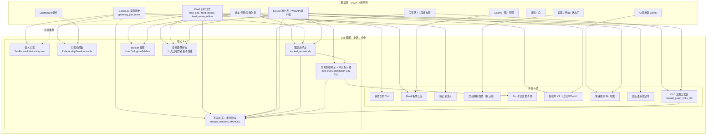

# VRCX-JIRAI 新增功能图谱（v3 · 接手复审版）

> **口径**：只统计 VRCX-jirai 相对 VRCX 上游的**新增功能**，忽略上游最新仓库给 VRCX-jirai 带来的新增（如 Dashboard 组件、Activity Heatmap 等）。
> **取证方式**：分析全程只读（无 checkout、无提交、无写盘）；本文件与《审查报告》为交付产出。
> **版本说明**：v1 有 15 处事实错误（见《审查报告》）；**v3（2026-11-17T23:23Z 接手复审）** 新增：①补入漏项 #16「OLD 互惠历史表」；②#7 自动跟随成因由「入口被注释」改为「作者主动隐藏」；③修正第 2 节表头/分类口径自相矛盾；④修正 Online 补线措辞（jirai 对**当前用户自己**有 Online/Offline 写入，对好友的启动补线才是无）；⑤第 6 节按 `ea3142a47` 实测重写，并消除 A11 与总表的矛盾。
>
> - 上游基准：`vrcx-team/VRCX` `master` = `e819c4e4`（2026-11-16；较首版记录的 `20fe6963` 前进 9 个提交，内容为 i18n/测试/类型清理 + 两个上游新功能「好友列表邀请徽章」「队列就绪闹钟」，**均未触及本图谱任何功能**，12 个特征关键词在最新上游仍全部 0 命中；2026-11-17T23:23Z 复核 `ls-remote` 仍为 `e819c4e4`）
> - Jirai 基准：`FuLuTang/VRCX-jirai` `refs/heads/master` = `c7eaf00e`（2026-09-27，发布版 2026.9.27；本图谱的首提交与文件行数均以此为准，本轮抽验 6 个文件行数全部吻合）
>   - 注：pc114514 另有一条未推送的开发线 `codex/vrcx-upstream-through-2026-08-15` = `bd2f45f0`（2026-10-02，266 提交、711 文件差异）。功能在两版上均存在，但**不止行号不同**：至少 Bio 数据源的上游 `publicProfileRef` 适配只在开发线有（发布线未适配）；详见《功能锚点与语义映射》第 8.6 节
> - **VRCX-0 基准**：`main` = `ea3142a47`（2026-11-16 全分支合并后；2026-11-17T23:23Z `ls-remote` 复核 `origin/main` 仍为 `ea3142a47`）；此前为 `port/legacy-audit-simple-ui` = `3200bc3c7`。`Map1en/VRCX-0` `master` = `732ca893d`
> - **git merge-base**（语义分叉点）：`d97327d8`（2026-04-27），也是最后一次合并上游的点
> - **jirai 侧第一个提交**：`a610a5bc`「Initial plan」（2026-03-23），其父 `163d75aa`（2026-03-20）才是分叉前最后一个上游提交

---

## 1. 独有性证明

判定标准：**同一路径/同一关键词在 VRCX 最新 master 中不存在**。
（注：`VRCX-jirai` 仓库存在同名 tag `refs/tags/master`=`36f3cb62`，与 `refs/heads/master`=`c7eaf00e` 冲突，所有核对均写全 ref 或直接使用 SHA。）

| 证据 | 实测 |
| --- | --- |
| `d97327d8..HEAD` 提交 | **227** 个（43 个 merge + 184 个非 merge） |
| 227 个提交作者分布 | FuLu糖福禄 94、copilot-swe-agent[bot] 90、Haochen TANG 27、FuLuTang 11、**pa 4**、Yutho 1 |
| 同一作者说明 | `FuLu糖福禄`/`Haochen TANG`/`FuLuTang` 邮箱同为 `tanghaochen0506@hotmail.com`；按邮箱合并后仅 4 个作者（132 / 90 / 4 / 1） |
| 上游作者混入 | **`pa <maplenagisa@gmail.com>` 是上游作者**（上游 master 有 977 个其提交），jirai 侧保留了 4 个（`265f38ae`、`8cd8a5de`、`01ad582b`、`0877fb87`，均为 3-30～3-31 的上游修复） |
| 相对分叉点变更 | **48 A + 97 M**（共 145 文件） |
| `src/` 下新增文件 | **24 个**（含 `BioFetchDialog.vue.bak` 备份，实际源码 **23 个**），逐个 `test -e` 对照上游：**24/24 不存在** |
| 13 个功能关键词在上游 `src/` | `autoFollow` `trackedNonFriends` `manualRelations` `manual_relations_MANUEL` `statusDistribution` `ProfileCompletion` `infoFetchCoordinator` `bioHistory` `relationshipTimeline` `TwoPersonRelationship` `aggregatedView` `accountHub` + **`links_old`（v3 补，对应 #16）** —— **全部 0 文件命中** |

结论：功能主体为 jirai 从零新增；仅 `pa` 的 4 个上游修复提交被保留。

---

## 2. 功能板块总表（17 个条目：编号 #1–#16 共 16 个 + 附属项 #3b）

> 「引入提交」= 该功能**首次出现**的提交（可能是修改既有文件，不一定是新增文件）。
> 编号约定：#1–#15 沿用 v1/v2 编号不变（避免破坏其他文档的引用）；#3b 为 #3 的附属项；**#16 是 v3 复审补入的漏项**。「层」列：核心 = #1–#6 + #3b（6 个编号功能 + 1 个附属项），其余为外围。

| # | 功能 | 层 | 入口 | 引入提交 | 代码规模 | 状态 |
| --- | --- | --- | --- | --- | --- | --- |
| 1 | 双人关系 | 核心 | Charts →「双人关系」tab | `03bbb72a`（03-23） | 540 行 | 完成 |
| 2 | 关系时间轴 | 核心 | Charts →「关系时间轴」tab + Dashboard 面板 | `9db97bac`（03-23） | 792 行 | 完成 |
| 3 | 手动关系 | 核心 | 关系网 →「手动关系」按钮 | `f66d455c`（03-31） | 866 行 | 完成 |
| 3b | 推测建议（附属于 3） | 核心 | 手动关系弹窗「推测建议」 | `392365f0`（04-21） | 含于上行 | 完成 |
| 4 | 追踪非好友 | 核心 | 侧栏「追踪」面板 | `f66d455c`（03-31） | 461 行 | 完成 |
| 5 | 信息抓取补全 + 同步指示器 | 核心 | Tools 弹窗 / 启动+重连自动 / 状态栏 | `dbe0885e`（03-31） | 418 行 | 完成 |
| 6 | Bio Diff 视图 | 核心 | 用户对话框 Info 页 | `0ed033b9`（03-24） | 786 行 | 完成 |
| 7 | 自动跟随好友 | 外围 | ~~好友侧栏按钮~~（**作者 `3a5c269e` 于 04-04 主动隐藏**，HTML 注释保留） | `4a38a56f`（03-26） | 203 行 | ⚠️ **代码完整但入口被作者主动下线** |
| 8 | 状态分布 Tab | 外围 | 用户对话框 → 状态分布 | `137abf6f`（03-30） | 458 行 | 完成 |
| 9 | Feed 拖放上传 | 外围 | Feed 页拖入图片 | `055c55b5`（04-11） | +105 行 | 完成 |
| 10 | 假记录注入 | 外围 | Previous Instances 对话框 | `c4f1a461`（04-29） | +145 行 | 完成 |
| 11 | 启动静默加群 | 外围 | 自动（群组加载后，**默认开启**） | `a77c6cf6`（03-26） | +23 行 | 完成 |
| 12 | Bio 清空突发清理 | 外围 | 自动（信息抓取流程内） | `198e07f8`（09-27） | +148 行 + 204 行测试 | 完成 |
| 13 | 多账户 V4 | 外围 | 登录页多选账号 | `17518d9b`（04-30）→ 重构 `733dab99`（05-02） | 1075 行 | ⚠️ **已合入 master，但设计文档为 Draft** |
| 14 | 快速搜索 Bio 历史检索 | 外围 | Ctrl+K 快速搜索 | `a94824c2`（03-31） | +73 行 | 完成 |
| 15 | 更新通道重定向到 jirai | 外围 | 自动（更新检查 / Changelog 链接） | `settings.js` 更新端点 + `link.js` 外链 | 少量 | 完成 |
| 16 | **OLD 互惠历史表（曾经好友关系 + 同步日期）** | 外围 | 关系网（历史边）+ 用户对话框「共同好友」页（日期徽章） | `1d9cd77c`（03-27，copilot） | `mutualGraph.js` 373 行中 7 个 `*Old` 函数 + 调用方 | 完成 |

> 分类依据（规模实测）：核心（#1–#6 + #3b）≈ 4,066 行（含 #7 的 203 行在内的旧统计口径，见下），外围（不含 #13）≈ 879 行；#8 状态分布 458 行规模接近核心项，归为外围是因为它只是对话框内一个 Tab，无独立表与调度。
> **口径说明**：v2 把 #7（203 行）算进「核心 7 项」，但 #7 在总表里标为「外围」，二者矛盾。v3 统一为：#7 为外围，核心 = #1–#6 + #3b；核心行数合计 540 + 792 + 866 + 461 + 418 + 786 = **3,863 行**（不含 #7 的 203），此前「≈ 4,066」= 3,863 + 203，即旧口径把 #7 算在内。

---

## 3. 闭环断言（已按实测修正）

### A1 双人关系

- **入口**：`src/plugins/router.js:122` 注册 `TwoPersonRelationship.vue`
- **逻辑**：`TwoPersonRelationship.vue`（540 行）调 `gameLog.js:1675 getCoInstanceHistoryBetweenFriends()`，SQL 主查询为 `FROM gamelog_join_leave a INNER JOIN gamelog_join_leave b`（`type='OnPlayerLeft'`）
- **补充数据源**：`getInferredLocationSessions`（`gameLog.js:1729-1745`）才用 `feed_gps` / `feed_online_offline` 推断
- **存储（只读 3 表）**：`gamelog_join_leave`、`{prefix}_feed_gps`、`{prefix}_feed_online_offline`；**不读 `feed_status`**
- **过滤**：4 处 `NOT IN ('', 'traveling', 'private', 'private:private')`；`a.time > 0 AND b.time > 0`
- **输出**：共享实例列表（`instance_count:157`、`total_coexistence_time:148`、`joinLeavesCount`）+ `self_present`/`self_not_present` 徽章（`:211-218`）
- **断言**：✅ 只读闭环（无 `executeNonQuery`）

### A2 关系时间轴

- **入口**：`router.js:128` 注册 `RelationshipTimeline.vue`；**另有 Dashboard 面板** `panelRegistry.js:41` 注册 `charts-timeline`（上游无此面板）
- **逻辑**：`RelationshipTimeline.vue`（589 行）+ `relationshipTimelineUtils.js`（203 行，位于 `src/views/Charts/components/`）
- **聚合内容**：**只聚合共处**（`aggregateFriendDaysToBuckets`，`relationshipScore = totalTime + joinCount*60000`），**无状态变更聚合**
- **归一化**：**0–100 百分比**（`toPercent = (value/total)*100`，`toFixed(2)`），不是 0–1
- **存储（只读单表）**：`gameLog.js:2001 getRelationshipTimelineData()` 只读 `gamelog_join_leave`，**不读 Feed**
- **输出**：曲线 + TopN 滑块（`friendCount`，默认 5）；**无平滑开关**（`smooth:false` 写死）；高亮是光标自动 `emphasis`/`dispatchAction`（`:443-498`），不是开关
- **断言**：✅ 只读闭环；算法由 `__tests__/relationshipTimelineUtils.test.js`（81 行）锁定

### A3 手动关系 + 推测建议

- **入口**：`MutualFriends.vue:78` `<Button>`（`:77` 为 Tooltip 包裹层）→ `ManualRelationsDialog.vue`（295 行）
- **存储**：独立表 `{prefix}_manual_relations_MANUEL(user_id_a, user_id_b, relation_type, added_at)`（`index.js:167`，`relation_type DEFAULT 'friend'`，PK(a,b)）
- **归一化**：db `:14` 与 store `:29` 均 `[userIdA, userIdB].sort()`
- **逻辑**：`stores/manualRelations.js`（395 行）+ `services/database/manualRelations.js`（176 行，`:104 getCandidateCoInstances`，事件三源 UNION：gamelog `:152` / feed_gps `:155` / feed_online_offline `:156`；另在源码注释「4.」步读取 `{prefix}_mutual_graph_links_old`（`:163-170`）作为旧互惠快照 `oldMutualSnapshot`，用于排除已知好友对——即依赖 #16）
- **输出**：`MutualFriends.vue:963` 注入人工边（`:976 addEdgeWithKey(...{manualRelation:true})`），颜色 `EDGE_MANUAL = '#31543d'` 绿（`:1039`/`:1220`），图例 `:69-70`
- **调用链**：`ManualRelationsDialog.vue:280` 与 `infoFetchCoordinator.js:232` 均调 `computeSuggestions()`
- **推荐不落库**：`ignoredSuggestionKeys`（Set，`:19`）、`ignoreSuggestion`（`:76`）仅内存
- **断言**：✅ 四段齐全

### A4 追踪非好友

- **入口**：侧栏 `TrackedNonFriendsSidebar.vue`（227 行，`Sidebar.vue:313` 挂载）；添加入口 `UserActionDropdown.vue:227/319 toggleTrackedNonFriend`
- **逻辑**：`stores/trackedNonFriends.js`（74 行）+ `coordinators/nonFriendCoordinator.js:13 refreshTrackedNonFriendsFlow()`
- **调度**：`updateLoop.js:159` 每秒 tick；`:39`/`:93` `nextNonFriendRefresh = 3600`（1 小时）
- **存储**：`{prefix}_tracked_nonfriends(user_id TEXT PRIMARY KEY, display_name, added_at)`（`index.js:164`）
- **输出**：侧栏列表；`infoFetchCoordinator.js:80-85 buildTargetList` 合并 `trackedList` 纳入抓取
- **断言**：✅ 齐全；不写好友表

### A5 信息抓取补全 + 同步指示器

- **入口**：`ProfileCompletionDialog.vue`（176 行，`:170 handleStart → runSilentInfoFetch`）；`friendSyncCoordinator.js:6` import、`:32`/`:80` 调用（登录/重连）；`StatusBar.vue:498` import 进度状态，UI `:326-360`、`:747-750`
- **逻辑**：`infoFetchCoordinator.js` **242 行**（v1 误写 196），`:69 buildTargetList()`、`:96 runSilentInfoFetch()`；`:97` 防重入、`seenIds` 去重、`:158-166` 失败 0.5s 重试一次
- **状态白名单**：`:199 ['join me','active','ask me','busy']`，offline 被过滤
- **存储**：bio 经 `:12` import 的 `recordBioObservation`（`:182`）；status 走 `database.addStatusToDatabase`（`:208`）
- **断言**：✅ 齐全

### A6 Bio Diff 视图

- **入口**：`UserDialogInfoTabJirai.vue`（786 行），`UserDialog.vue:114` 使用；上游原版 `UserDialogInfoTab.vue`（700 行）保留不动
- **逻辑（v1 描述错误）**：**打开面板不写入快照**。`:566 loadBioDiff()` → `database.getRecentBioChangesForUser(id, 50)`，从最近 1 天内的更早记录回推 baseBio，再与 `latestRecord.bio` 做 diff
- **快照真实写入方**：`bioHistoryCoordinator.recordBioObservation`（由 `userCoordinator.js:485` 等调用）
- **diff 实现**：`views/Feed/columns.jsx:433 formatDifference`，空白分词 + `CJK_CHAR_RE` 单字切分 + `joinTokens` 还原；内联 `x-text-added`/`x-text-removed` 高亮（`:203-205`），非行级 diff
- **断言**：✅ 齐全（修正后）

### A7 自动跟随好友 ⚠️ 入口被作者主动下线

- **逻辑**：`stores/autoFollow.js:36 watch` → `:38-39 f.ref?.location`；`:44 isRealInstance(newLocation) && newLocation !== locationStore.lastLocation.location`
- **动作**：`:48 launchStore.tryOpenInstanceInVrc(newLocation, null)`；`:50-51 AppApi.QuitGame()` + `launchStore.launchGame(newLocation, null, true)`（第 3 参 `desktopMode=true`，无延迟）
- **对话框**：`AutoFollowDialog.vue:104 startFollow(friend.ref)`
- **⚠️ UI 入口被注释（成因：作者主动隐藏，不是 bug）**：`FriendsSidebar.vue:203-211` 整块 `
…
` 处于 HTML 注释中。该注释由提交 **`3a5c269e`（2026-04-04，FuLu糖福禄，标题「隐藏"自动跟随"按钮」，2 行改动）** 引入，属于有意下线。`toggleAutoFollow`（`:272`）唯一调用点 `:207` 在注释内；`openAutoFollowDialog` 仅在 `:276`（`toggleAutoFollow` 内）被调
- **后果**：`isAutoFollowDialogOpen` 唯一写入点为 `autoFollowCoordinator.js:6 openAutoFollowDialog()`，因此 `MainLayout.vue:86` 挂载的 `AutoFollowDialog` **永远打不开**；`auto-follow-btn` 仅剩 `:993-1024` 孤立样式
- **与 VRCX-0 侧文档的关系**：`docs/jirai-feature-backlog.md:198` 把「自动跟随并启动／重启 VRChat」列为**暂缓**（与旧版作者自己隐藏入口的取舍一致）；`docs/jirai-port/执行任务/11-自动跟随好友实例.md` 保留了设计参考
- **断言**：❌ 逻辑闭环但**产品入口被作者主动下线**。移植时按"已下线功能"处理，不应当成"遗漏"

### A8 状态分布 Tab

- **入口**：`UserDialog.vue:52` 挂载 `<UserDialogStatusDistributionTab ref="statusDistributionTabRef" />`；`:116` import、`:160` ref、`:381` `loadStatusDistribution(userId)`
- **逻辑**：`UserDialogStatusDistributionTab.vue` **458 行**（v1 误写 374；374 是 `137abf6f` 创建时行数，`cf942bd0` 重构为时长制后变 458）
- **存储**：`feed.js:235 getStatusHistoryForUser()`（`137abf6f` 中 feed.js +22 行）
- **断言**：✅ 齐全

### A9 Feed 拖放上传

- **入口**：`Feed.vue:208 onDrop` → `:218 galleryStore.pendingDrop = { file, tab }` → `:219 showGalleryPage`
- **目标区**：`Feed.vue:155-161 dropZones` 五区，顺序 gallery/icons/emojis/stickers/prints
- **消费**：`Gallery.vue:745 watch(pendingDrop, …)` → `:748 pendingDrop.value = null`（先清后处理）
- **断言**：✅ 齐全；不新增上传通道

### A10 假记录注入

- **入口**：`PreviousInstancesInfoDialog.vue:131 @click="handleAddFakeRecord"`（文案「添加记录」在 `:135`）
- **逻辑**：`:217 async function handleAddFakeRecord()`；`:244 leaveMs = joinMs + 5000`；`:251 OnPlayerJoined`（time:0）、`:260 OnPlayerLeft`（time:5000）
- **存储**：写入既有 GameLog 表，不新增表
- **断言**：✅ 齐全

### A11 启动静默加群

- **入口**：自动，`groupCoordinator.js:645 getCurrentUserGroups()`
- **逻辑**：`:666 if (!hasDefaultGroup && currentUser?.id && autoJoinGroupCertification)` → `:668 groupRequest.joinGroup(...)`
- **groupId**：`:664 'grp_44b87c7b-00a6-4ef1-9980-0eddf3c7f06d'`
- **默认值**：**默认开启** —— `settings/advanced.js:74 ref(true)`、`:173 getBool('VRCX_autoJoinGroupCertification', true)`；UI `AdvancedTab.vue:29`
- **断言**：✅ 齐全；**默认生效、无提示、有外部副作用**，移植需显式决策（该决策已在 VRCX-0 侧做出：`docs/jirai-feature-backlog.md:205` 记录「开发者群默认开启」为已确定选择，`README.zh-CN.md:91` 向用户明示该默认行为）

### A12 Bio 清空突发清理

- **入口**：`infoFetchCoordinator.js:126 cleanupSuspiciousBioClearBurst(counts.total * 3)`
- **逻辑**：`bioHistoryCoordinator.js:84 findSuspiciousBioClearBurst()`、`:133 cleanupSuspiciousBioClearBurst(scanLimit)`
- **存储**：`feed.js:130 getRecentBioClearChanges`、`:144 getBioClearChangesBefore`、`:163 deleteBioClearChangesBetween`（`198e07f8` 中 feed.js +42）
- **测试**：`__tests__/bioHistoryCoordinator.test.js` **204 行**（v1 误写 108，108 是 `198e07f8` 的增量行数）
- **断言**：✅ 齐全

### A13 多账户 V4

- **入口**：`Login.vue:363 accountHub.addSession(secEntry)`（v1 误写 `:358`，358 是注释行）；`:371 switchToMerged()`
- **逻辑**：`accountHub.js` 413 行、`accountSession.js` 441 行、`aggregatedView.js` 221 行
- **聚合**：`FriendsSidebar.vue:262 import mergeFriends`、`:631 isMergedView && hasSecondarySessions`；`FriendItem.vue:111 getAccountColor`；`StatusBar.vue:524`
- **⚠️ 合并状态修正**：`733dab99` **已是 `refs/heads/master` 的祖先**（`merge-base --is-ancestor` 退出码 0），`refs/heads/master..origin/feat/multi-account` 计数 **0**；合并提交 `75e1c7e4`「Merge pull request #33 from FuLuTang/feat/multi-account」（2026-05-17）。**代码在 master 里**，v1 的"未合入 master"错误
- **WIP 依据**：只能靠 `docs/MULTI_ACCOUNT_V4_DETAIL_DESIGN.md` 标注 Draft + 旧版实现存在接口不完整（聚合视图引用 hub 未公开属性）
- **断言**：⚠️ 代码闭环，但产品成熟度未定

### A14 快速搜索 Bio 历史检索

- **入口**：`QuickSearchDialog.vue`（`a94824c2` +7 行）
- **逻辑**：`stores/quickSearch.js:212-237`，`:221 database.searchBiosByContent(q)`，去重后合并进搜索结果；`quickSearchWorker.js` +6、`searchIndex.js` +2
- **存储**：`feed.js` +23 行（`searchBiosByContent`）
- **上游对照**：上游 `quickSearch.js` / `quickSearchWorker.js` **无任何 bio 检索**（0 命中）
- **断言**：✅ 齐全；**v1 误把整项「快速搜索」当作上游已有而排除**

### A15 更新通道重定向

- **更新检查端点（真正生效）**：`src/shared/constants/settings.js:2 GITHU_API_URL = 'https://api.github.com/repos/FuLuTang/VRCX-jirai'`，`:24`/`:29` 的 `urlReleases` 取该端点（上游原值为 `https://api0.vrcx.app/releases/{stable,nightly}`，改动见 `6fcd325a`）；请求在 `vrcxUpdater.js:312` 发出
- **外链常量**：`src/shared/constants/link.js:2/4/5` 的 `wiki`/`troubleshooting`/`github` 指向 `FuLuTang/VRCX-jirai`；`ChangelogDialog.vue:31` 的版本链接指向 `.../VRCX-jirai/releases`
- **死常量**：`REPOSITORY`（`settings.js:1`）、`GITHUB_RELEASES_URL`（`:3`）、`urlLatest`（`:25/:30`）导出后无引用
- **断言**：✅ 改动真实存在；属发布通道变更，非用户功能。**v2 把它的锚点只写成 `link.js`，漏了真正生效的 `settings.js`，v3 已补**

### A16 OLD 互惠历史表（v3 复审补入）

- **入口**：关系网页 `MutualFriends.vue:1291` 读 `database.getMutualGraphSnapshotFromOld()`；用户对话框「共同好友」页 `UserDialogMutualFriendsTab.vue:172-173` 读 `getMutualsForFriendWithDateFromOld` / `getFriendLastFetchedFromOld`，并在 `:61-62` 渲染日期徽章、`:128 isLinkStale` 判定过期（灰/绿）
- **存储**：独立表 `{prefix}_mutual_graph_links_old(friend_id, mutual_id, date, PK(friend_id,mutual_id))`（`database/index.js:155`），**上游全库 0 命中 `links_old`**
- **写入**：`stores/charts.js:221-222`（单个好友刷新 → `updateMutualsForFriendInOld` + `updateFriendFetchTimeInOld`）、`:413-415`（整批 → `mergeMutualLinksToOld` + `bulkUpdateFriendFetchTimesInOld`）
- **逻辑**：`services/database/mutualGraph.js`（373 行）含 7 个 `*Old` 函数：`getMutualGraphSnapshotFromOld`(`:156`)、`getMutualsForFriendWithDateFromOld`(`:178`)、`mergeMutualLinksToOld`(`:195`)、`updateMutualsForFriendInOld`(`:240`)、`updateFriendFetchTimeInOld`(`:263`)、`bulkUpdateFriendFetchTimesInOld`(`:275`)、`getFriendLastFetchedFromOld`(`:304`)
- **被谁消费**：`manualRelations.js:170` 的 `getCandidateCoInstances` 第 4 路输入（旧互惠快照）读该表，故 #3b 推测建议依赖它
- **引入**：`1d9cd77c`（2026-03-27，copilot-swe-agent，「Add mutual_graph_links_old table with date field; update UI to show last sync date」）
- **v1/v2 为何漏掉**：它没有独立 `.vue`/新建 `.js` 文件（改的是既有 `mutualGraph.js`、`index.js`、`charts.js`），而 v1 的筛选依据是「`src/` 下 24 个新增文件」，修改既有文件的功能只能靠关键词补漏；v2 的 12 个关键词里没有 `links_old`
- **断言**：✅ 四段齐全（入口→逻辑→存储→输出），上游 0 命中，属 jirai 独有

---

## 4. 新功能图谱（v3，含 #16）

### 4.1 边的含义（v2 修正后）

| 边 | 含义 | v1 变化 |
| --- | --- | --- |
| `B3 → J1`，`B2 -.补充推断.→ J1` | 双人关系主读 GameLog，Feed 仅用于推断缺失会话 | **修正**（v1 写成 B2→J1 主依赖） |
| `B3 → J2`，`B6 → J2` | 时间轴只读 GameLog；另有 Dashboard 面板挂载点 | **补边** B6 |
| `B3/B2/B4/B9 → J3` | 手动关系叠加在互惠图 + SQLite 上，三源查询 | 保留 |
| `J4 → J3`，`J5 → J3` | 候选集来自「好友 ∪ 追踪非好友」；抓取完成自动重算 | 保留 |
| `B2/B7 → J9` | 拖放发生在 Feed 页，落到 Gallery 上传流程 | **补边** B2 |
| `B9 → J7` | 自动跟随用 `AppApi`/`launchStore` 启动游戏 | **补边** B9 |
| `B4/B9 → J16`，`J16 → J3` | OLD 表叠加在既有关系网刷新流程上；推测建议读它作旧互惠快照 | **v3 新增**（对应漏项 #16） |
| `J5 → J12` | Bio 清理挂在抓取流程内 | 保留 |
| ~~`J3 → J2`~~ | **删除**：时间轴不读手动关系（grep 零命中） | **修正** |
| ~~`J6 → J5`~~ | **删除**：Bio Diff 不依赖信息抓取（grep 零命中） | **修正** |
| `B5/B2 → J14` | Bio 检索扩展既有快速搜索，读 Feed bio | 新增 |
| `B9 → J15` | 更新通道是常量/客户端层改动 | 新增 |

---

## 5. 明确排除（上游已有，不算 jirai 功能）

经上游 `20fe6963` 抽验全部命中，确为共有基座：

| 排除项 | 上游证据 |
| --- | --- |
| 活动 V2 | `src/services/database/activityV2.js`（368 行） |
| Avatar Tags | `src/services/database/avatarTags.js`、`SetAvatarTagsDialog.vue` |
| Chatbox 黑名单 | `ChatboxBlacklistDialog.vue`（90 行） |
| Registry 备份 | `RegistryBackupDialog.vue`（275 行） |
| 笔记导出 | `NoteExportDialog.vue`（197 行） |
| 自动改状态 | `AutoChangeStatusDialog.vue`（423 行） |
| 关系网/共同好友 | `MutualFriends.vue`（1319 行）、`friendRelationshipCoordinator.js` |
| Dashboard | `src/views/Dashboard/`（含 `panelRegistry.js`） |
| Gallery / ScreenshotMetadata | `Gallery.vue`、`ScreenshotMetadata.vue` |
| My Avatars | `MyAvatars.vue`（887 行） |
| 通知中心 | `NotificationCenterSheet.vue`（138 行） |

**⚠️ 快速搜索需拆开看**：`Ctrl+K` 快速搜索**本体**是上游已有（`Sidebar.vue:381-384`），但 **Bio 历史检索是 jirai 新增**（`a94824c2`），不能整项排除 → 已提升为功能 14。

---

## 6. 与 VRCX-0-jirai 移植进度的对应（v3：按 `main` = `ea3142a47` 实测重写）

> **基准**：VRCX-0-jirai `main` = `ea3142a47`（2026-11-16 全分支合并后）。本节所有「文件:行」均在该提交的工作树上逐条核实（2026-11-17T23:23Z）。
> 旧版本（v2）本节含多处与代码不符的描述，已在下表「v3 修正」列标出。

| 本图谱功能 | VRCX-0-jirai 侧状态（`main` = `ea3142a47`） | v3 修正 |
| --- | --- | --- |
| A1 双人关系 | 已迁移：`TwoPersonRelationshipPageImpl.tsx` **830 行**（首行仍 `// @ts-nocheck`；`:128 getOverlapRows`、`:182 groupOverlapsByLocation`、`:258 computeTotalTime`、`:262` 组件；`:44` 从 `relationshipHistory` 引入 `buildRelationshipSessions`）；路由 `routes.tsx:251` | 行号全部更新 |
| A2 关系时间轴 | 已迁移：`RelationshipTimelinePageImpl.tsx` **506 行**（**已无** `@ts-nocheck`；`:66 relationshipChartOption`、`:190` 组件；`:29-34` 引入 `buildRelationshipDailyValues/buildRelationshipSessions/buildRelationshipTimeline/initialRelationshipTimelineZoom`）；路由 `routes.tsx:260` | 「工具库死代码」「自建 buildTimelineRows」说法**作废**——页面现已真正使用 `relationshipHistory.ts`（362 行 / 13 个导出） |
| A3 手动关系 | 已实现：表与 CRUD 在 `crates/persistence/src/mutual_graph.rs`（`:95` 列 / `:146 mutual_graph_manual_link_set` / `:167` 插 / `:176` 删；表名仍是 `{prefix}_manual_relations_MANUEL`，建表 `database/schema.rs:297` + 两个索引 `:300/:303`）；命令 `app__mutual_graph_manual_link_set`（`commands/local/mutual_graph.rs:72`）；UI `MutualFriendsRelationsManager.tsx`（311 行）；图叠加在 `src/lib/mutual-friends/mutualFriendsGraphData.ts:161`，渲染区分 `manual`/`historical`（`mutualFriendsSigmaGraph.ts:545-566`） | 「`overlayManualRelations` `:151`」已不存在；`relationType` 仍固定 `'friend'`（`:167`）此项保持 |
| A3b 推测建议 | **已实现，且算法与 jirai 逐项一致**：算法本体 `src/features/charts/relationshipRecommendationsAlgorithm.ts`（**421 行，位于 `relationship-recommendations/` 目录之外**）——`instanceWeightMap`（`:157-167`：invite/invite+/private 1.0、friends 1.8、friends+ 1.2、hidden 1.2、group 系 1.0、public 0.5）、`hardMatch`（`:107-112`）、`mePresent`（`:115-124`）、180000ms 窗口（`:195/200-201`）、密度加成（`:341`）、独立率惩罚（`:356`）均与 jirai `stores/manualRelations.js` 对应；目录内 **11 个文件 1486 行**（含 `legacyManualRelations.fixture.json` 97 行作回归夹具）；「会话内忽略」= `relationshipRecommendationsService.ts:18/161-174` 的 `ignored: Set`；进房提醒 Rust 链路：前端 `commands.appRelationshipRecommendationsSet`（`service.ts:63`）→ `overlay_activity.rs:14 app__relationship_recommendations_set` → `application-game/.../relationship_recommendations.rs:16 RelationshipRecommendationCache`（183 行）→ `ActivityKind::RelationshipRecommendation` | 规模 10 文件 1389 行 → **11 文件 1486 行 + 外置 421 行算法**；「需复核权重」**已完成**（权重一致） |
| A4 追踪非好友 | 已实现：`tracked_nonfriends.rs`（200 行：`:32 list/:54 add/:74 remove/:87 is_tracked/:104 update_name`）；建表 `realtime/schema.rs:87`；命令 `commands/local/tracked_nonfriends.rs`（5 个）；`trackedNonfriendsStore.ts:52`、侧栏 `TrackedNonfriendsSidebar.tsx`（`SidePanel.tsx:456` 挂载）、资料页入口 `UserDialogHeaderActions.tsx:214 toggleTrackedNonfriend`；刷新 `trackedNonfriendsRefreshExecutor.ts:178`（`:197` 注册）。**缺口保持**：`realtime/jirai.rs:83` 拒绝非好友做 Online 补线，故无独立 Online/Offline 事件流 | 无变化 |
| A5 信息抓取 | 已实现，且**比 v2 描述的完整**：执行体 `enhancedProfileFetchExecutor.ts`（380 行，`:82 createProfileFetchExecutor`，目标 = 好友 ∪ 追踪非好友 `:104-125`，失败重试 `RETRY_INTERVAL_MS=3000`）；`profileFetchExecutor.ts` 仅 48 行装配并 `registerProfileFetchExecutor`；调度服务 `enhancedInfoFetchService.ts`（400 行，`:336 initializeEnhancedInfoFetch` 由 `main.ts:9` 启动，订阅原生好友基线完成事件、`reconnect` 不触发、配置键 `enhancedInfoFetchEnabled` 默认 true）；**状态栏常驻进度已存在**：`EnhancedInfoFetchStatus`（`StatusBarFooter.tsx:113`）；**目标数预览已存在**：`getEnhancedInfoFetchTargetCounts`（`:95`）；落库 `realtime/jirai.rs:123 profile_feed_reconcile`；工作流弹窗 `SyncWorkflowDialog.tsx` | v2「无 StatusBar 常驻进度」「无目标总数预览」「250ms 节流」**三条作废**；`manual-relations-sync` 与 `relationship-recommendations` 两个工作流动作仍是 `skippedAction` 桩（`syncWorkflowActions.ts:121/133`） |
| A6 Bio Diff | 已迁移：`UserDialogInfoTab.tsx:664 UserDialogBioPanel`；历史源 `feedRepository.queryFeed`（`:703`）；**词级内联 diff 已有**：`bioHistory.ts:71 buildInlineBioDiff`（CJK 感知，`tokenizeBio` + segments，测试 `bioHistory.test.ts:83`）+ 分组 `groupBioHistoryRows`（`:32`）；行级 `historyUtils.ts:92 buildLineDiff` 另存 | v2「行级而非词级」**作废** |
| A7 自动跟随 | **未实现**（`autoFollow`/`tryOpenInstance` 在代码中 0 命中，仅 docs 提及）；与 jirai 作者主动隐藏入口、VRCX-0 backlog 标「暂缓」一致 | 补成因 |
| A8 状态分布 | 已迁移并扩展：`statusDistribution.ts`（**288 行**，`:170 buildStatusDistribution`、`:204 statusBucketDays`、`:221 buildStatusDistributionBuckets`、`:196 STATUS_DISTRIBUTION_COLORS`）；面板已拆为独立文件 `UserDialogStatusDistribution.tsx`，**挂在「Activity」标签**（`UserDialogDataTabs.tsx:624`），查询在 `statusDistributionQuery.ts` | v2「`UserDialogInfoTab.tsx:862` 面板」**作废**，位置改为 Activity 标签 |
| A9 Feed 拖放 | 已实现：`FeedImageDropOverlay.tsx`（`:13 FEED_IMAGE_DROP_TARGETS`、`:119 onFileDragDrop`，Tauri 原生拖放）→ `FeedPage.tsx:35` 路由 state → `useFeedImageDropIntake.ts:24 readFeedImageDrop` → `useGalleryPageController.ts:140` | 无变化 |
| A10 假记录注入 | 未完成：管道在（`app__game_log_entries_add`、`gameLogPersistenceRepository.ts:75 addGameLogEntries`、`:187 addGamelogExternalToDatabase`），但除这两个封装与 `bindings.ts:228` 外**无任何 UI 调用方**；backlog `:198` 明列「暂缓：手动插入实例进出记录」 | 补暂缓出处 |
| A11 启动加群 | **已实现**：`useMyGroupsPageState.ts:120-142`（`defaultGroupId='grp_44b87c7b-…'`，`shouldAutoJoin` = 偏好已水合 ∧ `autoJoinGroupCertification` ∧ 未加入 ∧ 本用户未尝试过）→ `groupProfileRepository.joinGroup` → 重拉群组；有测试「does not join from a stale account group response」（`useMyGroupsPageState.test.tsx:236`）；**触发时机是进入「我的群组」页并完成偏好水合后**，不是 jirai 的「登录后群组加载完成即触发」；README.zh-CN `:91` 明示默认开启 | **消除 v2 内部矛盾**（v2 同时写「完成」与「调用路径仍待确认」）；补上触发时机差异 |
| A12 Bio 清理 | **清理无、预防有**：无历史清理（`bioClear`/`suspiciousBio`/`clearBurst` 零命中；唯一 `suspicious` 命中是 `crates/application-realtime/src/social_baseline/service/friends/baseline.rs:123 collect_suspicious_friend_ids`，同名不同义）；但污染源已在写入路径堵住——`realtime/jirai.rs:144` 的 `input.bio` 为 `Option<String>`、`:186 bio_updated` 仅 `Some` 才触发，前端 `enhancedProfileFetchExecutor.ts:263` 缺字段即省略，测试 `realtime/jirai/tests.rs:225`。**且 #12 的 `198e07f8`（2026-09-27）晚于 VRCX-0 盘点截止点 `c8b8f744`（2026-05-20，`README.zh-CN.md:85`），从未被盘点** | **重新定性**：由「未迁移」改为「按场景」（仅迁入 jirai 旧库历史污染时才需清理） |
| A13 多账户 | 明确排除：`docs/jirai-port/多账户进程隔离-RFC.md`；VRCX-0 仅有「已保存账号 + 切换」；backlog 条目 7 标「待独立设计」 | 无变化 |
| A14 快速搜索 Bio 检索 | 未迁移：全局快速搜索目录 `quick_search_catalog.rs:111-120` 仅 7 类（friends/own_avatars/favorite_avatars/own_worlds/favorite_worlds/own_groups/joined_groups）；Feed 页内有 bio LIKE（`feed/query.rs:300`，**查历史行含 `previous_bio`**）；**产品暂缓**：`README.zh-CN.md:122` 与 backlog `:95-105` 记录「用户 2026-10-02 决定暂不优化搜索」 | 补暂缓出处；jirai 用 `MAX(id)` 只匹配每人**最新**一条（backlog `:99` 已纠正此前"遍历全部历史"的误读） |
| A15 更新通道 | N/A（VRCX-0-jirai 有自己的发版通道，`release.yml` → GitHub Release 草稿） | 无变化 |
| **A16 OLD 互惠历史表** | **已实现，且比 jirai 更严**：表 `database/schema.rs:291`（同名 `{prefix}_mutual_graph_links_old`，同结构）；`mutual_graph.rs:64 mutual_graph_history_get`（按好友取）、`:224`（整表快照）、`:402`（写入，`ON CONFLICT … WHERE julianday(excluded.date) >= julianday(date)` 只让日期前进）、`:431 mutual_graph_observation_archive`（含 `observation_is_stale` 过期观测保护，**jirai 无此保护**）；前端 `mutualFriendsGraphData.ts:68/114 historicalLinks` → 边 `historical: true` 淡化渲染（`mutualFriendsSigmaGraph.ts:546-563`）；命令 `app__mutual_graph_history_get`（`:33`）。backlog `:205` 记录语义「OLD 日期表示最后成功确认时间」 | **v3 新增行** |
| — 启动 Online 补线 | **VRCX-0-jirai 新增**：jirai 老版**对当前用户自己**有 Online/Offline 写 Feed（`userCoordinator.js:315`，条件 `ref.id === currentUser.id`，引入于 `cf942bd0`），但**没有**对好友的「启动时补 Online 边」；VRCX-0 的 `realtime/jirai.rs:37 insert_startup_online_backfill` 才是后者（`:83` 仅限当前好友） | **措辞修正**：v2「jirai 老版无此实现」过宽，应限定为「对好友的启动补线」 |

**v3 统计（17 个条目 = 编号 #1–#16 共 16 个 + 附属项 #3b；与《功能锚点与语义映射》第 3 节、《完成度清单》同一口径）**

| 分类 | 条目 | 数量 |
| --- | --- | --- |
| 已落地（代码 + 入口接通 + 有测试） | 1、2、3、3b、4、5、6、8、9、11、16 | **11** |
| 半截 | 14（有 Feed 页历史行检索，无全局快速搜索入口，且语义不同） | **1** |
| 管道在、入口缺 | 10（Rust 命令与仓库方法在，无 UI 调用方） | **1** |
| 无 | 7、12、13 | **3** |
| 不适用 | 15 | **1** |
| 合计 | | **17** |

> #12 记为「无」仅指「历史清理功能无」；其**写入侧预防已具备**，且 #12 晚于 VRCX-0 盘点截止点、从未被盘点（见 A12 行与《映射》#12 小节）。若按「是否仍需移植」口径，#12 只在迁入 jirai 旧库场景才需要。

「已落地」中 5 为能力等价但形态不同（工作流弹窗 + 状态栏替代 jirai 的单弹窗）、9 落 Gallery 上传队列、11 触发时机不同于 jirai（见 A11 行）。

> **验收口径提示**：VRCX-0 侧 `docs/jirai-feature-backlog.md` 与 `docs/jirai-port/2026-10-13-实机验收与修复队列.md` 明确区分「代码已接入」与「实机验收通过」。本图谱的「已落地」只表示**代码与入口接通且测试存在**，**不含**真机验收结论。

**与 v2 统计的差异**：v2 为「9 项高等价 / 1 中 / 2 低 / 3 无 / 1 N/A」（合计 16 条目）。v3 变化：① #11 由「低」升为已落地（v2 的 #11 行与第 6 节互相矛盾，v3 统一）；② 新增 #16 并计为已落地；③ #14 由「中」改称「半截」（同义）；④ #10 由「低」改称「管道在入口缺」（同义，措辞更准）。

---

> **2026-11-18T04:15Z 基线口径更新：现统一以 GitHub VRCX-jirai 主分支 `refs/heads/master` @ `c7eaf00e`（相对上游 VRCX 的差分 `d97327d8..c7eaf00e`）为唯一差分参考基线，`c8b8f744` 不再作为「历史对照」基线。决议见 `docs/jirai-port/计划/Rust重写路线/README.md` 第 1.0 节。**本图谱头部的 Jirai 基准与 merge-base 与该口径一致，内容无需改动。

> **2026-11-18T04:43Z 补充：VRCX-0-jirai 侧基线冻结在 pc114514 的 `ea3142a47`**（`C:\Users\tangh\Documents\GitHub\VRCX-0-jirai`，`main`）。本图谱里 VRCX-0 侧的现状描述取证于同一提交，无需改动。决议见 `docs/jirai-port/计划/Rust重写路线/README.md` 第 1.0b 节。
