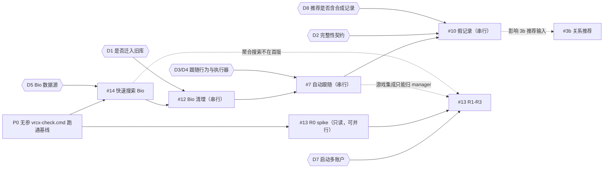

# VRCX-JIRAI 专属功能 · Rust 重写开发路径

> **2026-11-27 文档整理说明**：本文引用的 `JIRAI_移植说明.md`、`docs/jirai-port/执行任务/`、`后续迁移计划.md`、`评审结论与迭代计划.md` 以及 `docs/jirai-port/reports/` 下的 6 份复杂功能报告已删除，原文可用 `git show e6143d256:<路径>` 查看。`reports/2026-11-18T0040Z-pc-vs-github-jirai-audit/` 未入库，已一并删除；其基线结论见本文第 1.0 节。

| 项               | 值                                                                                                                                                                                                                                                                                                                                                                                                                                                                                                                                                                                                                                                                                                                                                                                                                         |
| ---------------- | -------------------------------------------------------------------------------------------------------------------------------------------------------------------------------------------------------------------------------------------------------------------------------------------------------------------------------------------------------------------------------------------------------------------------------------------------------------------------------------------------------------------------------------------------------------------------------------------------------------------------------------------------------------------------------------------------------------------------------------------------------------------------------------------------------------------------- |
| **报告时间戳**   | 创建 `2026-11-18T00:53:13Z`（UTC；北京时间 08:53）；修订 1 `2026-11-18T01:01Z`（同目录新增 `完善计划.md`）；**修订 2 `2026-11-18T01:17:56Z`**（依 `JIRAI_移植说明.md` 与 `总执行规划.md` 去掉原「决定事项 1（并行）」「决定事项 2（红线）」，并加入开发分支历史核查，见第 2.1、2.6 节）；**修订 3 `2026-11-18T04:15Z`**（基线重定向：统一以 GitHub VRCX-jirai 主分支为「相对上游 VRCX 的差分参考基线」，见第 1.0 节）；**修订 4 `2026-11-18T04:43Z`**（VRCX-0-jirai 侧基线冻结在 pc114514 的 `ea3142a47`，见第 1.0b 节）；**修订 5 `2026-11-18T05:52Z`**（新增《闭环断言.md》；「已完成功能不再改动」使 4.3 与 D8 有变，见各处标注）；**修订 6 `2026-11-18T15:29Z`**：冻结 #6、#10、#12（**4.2、4.3 整节作废**，只留作追溯）；D3、D6 与 jirai 同义（4.4 的冷却与首启确认不做）。现行计划以同目录《完善计划.md》修订 6 为准 |
| 范围             | 《VRCX-0-jirai 功能板块完成度清单》中标注为「部分完成」的 **#10 假记录注入、#14 快速搜索 Bio**，与「未完成」的 **#7 自动跟随、#12 Bio 清空突发清理、#13 多账户**（清单位于 `docs/jirai-port/参考/VRCX-0-jirai 功能板块完成度清单.md`，v2）                                                                                                                                                                                                                                                                                                                                                                                                                                                                                                                                                                                 |
| 蓝图来源         | 《VRCX-JIRAI新增功能图谱.md》（v3）+ **本文第 1.0 节的统一基线**（修订 3 起取代原 1.2 的「蓝图 + 历史对照」双基线）                                                                                                                                                                                                                                                                                                                                                                                                                                                                                                                                                                                                                                                                                                        |
| 取证对象         | **VRCX-0-jirai 冻结基线 = `ea3142a47`**，位置 pc114514 `C:\Users\tangh\Documents\GitHub\VRCX-0-jirai`（`main`，修订 4）；本机同一提交的只读副本在 `/home/fulutang/Documents/Github/VRCX-0-jirai-integrate`。jirai GitHub 主分支 `refs/heads/master` = `c7eaf00e`。2026-11-18T04:15Z–04:43Z 经 `git ls-remote` 与 ssh 复核，均未变化                                                                                                                                                                                                                                                                                                                                                                                                                                                                                        |
| 性质             | **只是路径，不是实施**。本轮未修改任何仓库文件、未改动 pc114514，只写了本目录                                                                                                                                                                                                                                                                                                                                                                                                                                                                                                                                                                                                                                                                                                                                              |
| 关于「另一对话」 | 指会话 `e7126849`（标题「确定VRCX-JIRAI基线」），其报告在 `reports/2026-11-18T0040Z-pc-vs-github-jirai-audit/README.md`                                                                                                                                                                                                                                                                                                                                                                                                                                                                                                                                                                                                                                                                                                    |

---

## 0. 一页摘要

**基线（修订 3，统一）**：**唯一的差分参考基线 = GitHub `FuLuTang/VRCX-jirai` 主分支（默认分支 `refs/heads/master`）= `c7eaf00e`（tag `2026.9.27`）**；「jirai 专属内容」一律定义为它相对上游 VRCX 的差分 `d97327d8..c7eaf00e`（`d97327d8` 是二者的 merge-base）。该仓库**没有名为 `main` 的分支**，我把你说的「MAIN」读作主（默认）分支——读错请指出。`c8b8f744` 不再担任任何基线角色（只是祖先提交 + VRCX-0 旧盘点的截止点）；pc114514 开发线 `bd2f45f0` 仍不作基线。对五个功能的设计结论**没有变化**（原蓝图本来就是 `c7eaf00e`），变化的是 #12 的定位与引用口径，见 1.0。

**VRCX-0-jirai 侧基线（修订 4，冻结）**：**pc114514 上的 `ea3142a47`**（`C:\Users\tangh\Documents\GitHub\VRCX-0-jirai`，分支 `main`）。「完成 / 部分 / 未完成」一律对这个提交判定，它不随 `main` 以后的提交移动。本文与《完成度清单》原本就是按 `ea3142a47` 取证的，所以**结论与行号都不用改**。注意：本机当前工作目录 `/home/fulutang/Documents/Github/VRCX-0-jirai` 检出的是旧分支 `port/legacy-audit-simple-ui` @ `3200bc3c7`，比基线落后 87 个提交，**不是基线**，见 1.0b。

| #   | 功能             | 现状                     | Rust 重写形态（一句话）                                                                                                     | 估算                 | 先决门                     |
| --- | ---------------- | ------------------------ | --------------------------------------------------------------------------------------------------------------------------- | -------------------- | -------------------------- |
| 14  | 快速搜索 Bio     | 部分：Feed 页有、全局无  | 给 `QuickSearchDetailStore` 加 `user_bios`，数据取 `profile_bio_list`（**零新增 SQL**），`QuickSearchMatchedField` 加 `Bio` | ≈3 格                | D5                         |
| 12  | Bio 清空突发清理 | 未完成（但新写入已预防） | 持久化层纯函数检测 + **「预览→确认」**的维护命令，入口放设置→高级→故障排除                                                  | ≈5 格                | **D1**（先问要不要迁旧库） |
| 10  | 假记录注入       | 部分：有管道无入口       | 独立表 + 专用命令 + `provenance=manual_synthetic`，**默认被所有分析路径排除**，实例详情里显式并入                           | ≈8.5 格              | **D2、D8**                 |
| 7   | 自动跟随好友     | 未完成                   | 纯状态机 + 端口 trait（置于 `contracts`/`runtime-event`），composition 串接 friend-place 与游戏状态；执行复用现有启动流程   | ≈7.5 格              | **D3、D4**                 |
| 13  | 多账户           | 未完成（RFC：不实现）    | 严格按 RFC：manager + `HeadlessData` worker + 本地 IPC；**先做 R0 spike + 安全评审**                                        | R0≈2 格；整体 15+ 格 | **D7**（RFC 要求另开任务） |

串行合计 ≈ 24 格（各包估算直接相加）；把 10.0 与 7.0 两个**只读** spike 前置并行后，写入阶段约 22 格；**另需每包约 0.5 格写 brief（R-i，四包约 +2 格，未计入上面）**，所以完整口径是 M0 的 1–3 格 + 24 格 ≈ 25–27 格（《完善计划.md》第 4 节）。「格」= 一天一格，**是我的估算，未实测**。

**执行方式不再是待决事项（修订 2）**：依 `docs/jirai-port/总执行规划.md:187-190`（共用同一个工作区、写入范围重叠必须串行）与 `:102`（进入条件「工作区干净、写入范围不重叠」），本路径**默认串行、单一工作区、不新增分支**。我核对了各功能包的写入范围：**四个包（#14/#12/#10/#7）都要改 `bindings.ts`（生成物）与 `zh-CN.json`/`en.json`**（#14 通过 `QuickSearchMatchedField` 枚举与 `QuickSearchResult` 结构变更进入 `bindings.ts`）；**#12/#10/#7 还共同改 `bindings_export.rs`、`commands/local/mod.rs`、`contracts/jirai.rs`**。写入范围重叠，所以规则本身就把它们定为串行——原先「3 轨并行 ≈ 11 格」的方案与该规则冲突，已删除。只读 spike（无写入范围）可以并行。依据与分支历史核查见第 2.1、2.6 节。
可执行的里程碑、完成证据、决策门未答复时的默认行为、回写清单与风险登记簿，都在同目录的 **[完善计划.md](完善计划.md)**。

**仍待你在「计划修补完毕」后决策的**：第 5 节的 8 个决策门（D1–D8）、是否「开工 #xx」、是否把 pc 上 266 个未推送提交备份成分支。其中 D1（是否迁入 jirai 旧库）同时决定 #12 做不做、#6/#8 的旧自身历史补迁做不做。

---

## 1. VRCX-JIRAI 基线决议

### 1.0 修订 3：基线重定向（现行口径，优先于 1.2–1.4）

> **统一基线 = GitHub `FuLuTang/VRCX-jirai` 主分支 `refs/heads/master`，钉在 `c7eaf00e`（tag `2026.9.27`）。**
> **差分定义：jirai 专属内容 = `git diff d97327d8 c7eaf00e`**（`d97327d8` = 与上游 `vrcx-team/VRCX` 的 merge-base，也是最后一次合并上游的点）。
> 不再区分「蓝图」与「历史对照」；规划、锚点、完成度判定全部只对这一个提交说话。

**「MAIN」的解读（修订 5：已由你确认——「main 指主分支，master 正确」）**：远程没有 `refs/heads/main`（`git ls-remote origin refs/heads/main` 为空）；默认分支是 `master`，基线就是它。

本轮（2026-11-18T04:15Z）重新取证的事实：

| 事实                | 命令                                                             | 结果                                                                                                |
| ------------------- | ---------------------------------------------------------------- | --------------------------------------------------------------------------------------------------- |
| 远程默认分支        | `git ls-remote --symref origin HEAD`                             | `ref: refs/heads/master`，`c7eaf00e738b…`                                                           |
| 是否有 `main`       | `git ls-remote origin refs/heads/main`                           | 无                                                                                                  |
| 发布 tag            | `git ls-remote origin 'refs/tags/*'`                             | `2026.9.27^{}` = `c7eaf00e`；另有同名 tag `refs/tags/master` = `36f3cb62`（裸写 `master` 的坑仍在） |
| 本地与远程一致      | `git status -sb`、`for-each-ref`                                 | 本地 `master` = `origin/master` = `c7eaf00e`                                                        |
| 与上游的 merge-base | `git merge-base c7eaf00e upstream/master`                        | `d97327d8`（2026-04-27，`v2026.02.11-526-gd97327d8`）                                               |
| 差分规模            | `git rev-list --count`、`git diff --shortstat d97327d8 c7eaf00e` | 227 个提交（184 非合并）；145 个文件（48 新增 / 97 修改），+21225 / −2032                           |
| 落后上游            | `git rev-list --count c7eaf00e..upstream/master`                 | 410 个提交（本地 `upstream/master` = `20fe6963`，本轮未重新 fetch 上游）                            |
| 旧基线的包含关系    | `git merge-base --is-ancestor`                                   | `c8b8f744`、`198e07f8`（#12）都是 `c7eaf00e` 的祖先                                                 |

**相对修订 2 改了什么**：

| 项                        | 修订 2                                                             | 修订 3                                                                                                                                    |
| ------------------------- | ------------------------------------------------------------------ | ----------------------------------------------------------------------------------------------------------------------------------------- |
| 基线个数                  | 两个：蓝图 `c7eaf00e` + 历史对照 `c8b8f744`                        | 一个：`c7eaf00e`                                                                                                                          |
| `c8b8f744`                | 「历史对照」                                                       | 不是基线。只保留两个事实：它是祖先；`README.zh-CN.md:85` 的旧盘点截止于它                                                                 |
| 「专属功能」的定义        | 沿用图谱，未在本文写明                                             | 写明 = `d97327d8..c7eaf00e` 的差分                                                                                                        |
| #12 的定位                | 1.4 留了一个口子：若按 `c8b8f744` 定义基线，#12 属「盘点范围之外」 | 口子关闭：#12（`198e07f8`）在基线内，是**基线内的未完成项**。做不做仍由 D1 决定，但理由只能是产品取舍（是否迁旧库），不能再是「不在范围」 |
| 五个功能的设计（第 4 节） | 以 `c7eaf00e` 为蓝图                                               | **不变**。第 4 节原本就全部引自 `git show c7eaf00e:<path>`                                                                                |
| pc 开发线 `bd2f45f0`      | 不作蓝图                                                           | 不变；它不在 GitHub 主分支上，按新口径自然不在基线内                                                                                      |

**钉住规则**：基线跟的是提交号，不是会动的分支名。以后主分支前进时，先 `git ls-remote` 取新 SHA，再对 `c7eaf00e..<新SHA>` 做一次差分复核，然后才更新文档里的 SHA；在那之前所有引用仍指 `c7eaf00e`。

**对其它文档的影响**：《新增功能图谱》（`:8`、`:11`、`:23`）与《锚点与语义映射》（`:7`）本来就以 `refs/heads/master` = `c7eaf00e`、merge-base `d97327d8`、227 个提交为准，与新口径一致，**锚点无需重做**；我只在它们和《完成度清单》里各加了一条指向本节的说明。

### 1.0b 修订 4：VRCX-0-jirai 侧基线冻结

> **VRCX-0-jirai 基线 = pc114514 `C:\Users\tangh\Documents\GitHub\VRCX-0-jirai` 上的 `ea3142a47269b13b8dc757f4bbe0f0197f3c37ab`（分支 `main`），冻结。**
> 两条基线合起来就是本路径的全部参照：**做成什么样**看 jirai `c7eaf00e`（1.0），**现在做到哪**看 VRCX-0-jirai `ea3142a47`。

2026-11-18T04:38Z–04:43Z 取证：

| 位置                                                                              | 分支 @ 提交                                               | 状态                                                                                                                                     | 命令                                                                        |
| --------------------------------------------------------------------------------- | --------------------------------------------------------- | ---------------------------------------------------------------------------------------------------------------------------------------- | --------------------------------------------------------------------------- |
| **pc114514** `C:\Users\tangh\Documents\GitHub\VRCX-0-jirai`（**基线所在**）       | `main` @ `ea3142a47`                                      | 与 `origin/main` 同步；工作区只有 1 个未跟踪目录 `target-novr/`，没有已跟踪文件的改动                                                    | ssh + `git -C … rev-parse HEAD`、`status --short --branch`、`worktree list` |
| GitHub `FuLuTang/VRCX-0-jirai`                                                    | `main` = `integrate/main-2026-11` = `ea3142a47`           | 默认分支 `main`                                                                                                                          | `git ls-remote --symref origin`                                             |
| 本机 `/home/fulutang/Documents/Github/VRCX-0-jirai-integrate`                     | `integrate/main-2026-11` @ `ea3142a47`                    | 与远程同步；只有未跟踪的 `node_modules`                                                                                                  | `git status --short --branch`                                               |
| 本机 `/home/fulutang/Documents/Github/VRCX-0-jirai`（当前工作目录，**不是基线**） | `port/legacy-audit-simple-ui` @ `3200bc3c7`（2026-11-11） | 是 `ea3142a47` 的祖先，落后 **87** 个提交、差 439 个文件（+29080 / −13007）；另有 1 个已跟踪文件的未提交改动和若干未跟踪文档（含本报告） | `git rev-list --count`、`merge-base --is-ancestor`、`diff --shortstat`      |

**为什么当前工作目录不能当基线**：那 87 个提交正是 2026-11-16 合并进 `main` 的内容。例如 `src/services/enhancedInfoFetchService.ts`、`enhancedProfileFetchRequest.ts`、`enhancedProfileFetchExecutor.ts` 在 `3200bc3c7` 上不存在、在 `ea3142a47` 上存在（`git cat-file -e`）。按 `3200bc3c7` 判定的话，《完成度清单》的 11 / 2 / 3 / 1 要全部重做，而且会把已合并的成果算成「没做」。

**「冻结」在本文里的含义**：

1. 基线是提交号 `ea3142a47`，不是分支名 `main`。开工后 `integrate/main-2026-11` 会前进，基线不跟着动。
2. 每个包完成后，「完成度」的变化写成「相对 `ea3142a47` 新增了什么」，回写到《完成度清单》时注明新提交号；不回头改基线。
3. 目前**没有 tag 指向 `ea3142a47`**（pc 上 `git tag --points-at` 为空），冻结只是文档约定。要让它不靠约定，可以打一个 tag（例如 `baseline/2026-11-18`）并推送——这是仓库写入，**我没有做**，等你一句话。
4. 三处副本（pc、GitHub、本机 integrate 工作树）现在是同一个提交，读代码取证用哪份都等价；但发生分歧时**以 pc114514 那份为准**。

**对计划的影响**：没有需要改的设计、写入点或估算——第 2–6 节原本就是对 `ea3142a47` 取证的（修订 2 时用的是本机 integrate 工作树，与 pc 是同一提交）。唯一的实际变化是口径：基线从「`main` 指到哪算哪」变成「冻结在 `ea3142a47`」，以及权威位置从本机改为 pc114514。

**顺带核实的一件事**：`vrcx-check.cmd` 用的验证工作树 `C:\Users\tangh\vrcx0-integrate` **当前在 pc 上不存在**（`git worktree list` 只有主仓库一项）。脚本里有 `if not exist … git worktree add --detach`，会在下次运行时重建，所以不阻塞；但这说明第 2.4 节描述的往返流程我仍然没有实际跑过。

> 下面 1.1–1.4 是修订 2 的原文，保留作推理记录。其中「后续蓝图 / 历史对照」的二分法已被本节取代；1.1 的复核事实仍然成立。

### 1.1 对另一会话结论的独立复核

我没有直接采信，逐条回到源头重新取证：

| 另一会话的论断                                                                                                  | 我的复核方法                                                               | 结果                                                                                                                                                                                                                                                         |
| --------------------------------------------------------------------------------------------------------------- | -------------------------------------------------------------------------- | ------------------------------------------------------------------------------------------------------------------------------------------------------------------------------------------------------------------------------------------------------------ |
| `c8b8f744` 上 `runSilentInfoFetch` 在 `:86`、文件 196 行；`refreshTrackedNonFriendsFlow` 在 `:12`、结束于 `:87` | `git show c8b8f744:<file>` + `wc -l` + `grep -n`                           | ✅ 复现：86 / 196 / 12 / 87                                                                                                                                                                                                                                  |
| `c7eaf00e` 上这些位置变成 `:96` / 242 行 / `:13`                                                                | 同上                                                                       | ✅ 复现：96 / 242 / 13                                                                                                                                                                                                                                       |
| `c8b8f744..c7eaf00e` 恰 5 个提交，均为 2026-09-27                                                               | `git log --format=%ai`                                                     | ✅ 00:55:44 – 01:19:37 +0800，作者均为 FuLu糖福禄                                                                                                                                                                                                            |
| 这段区间只改 11 个文件、没有已移植功能被改                                                                      | `git diff --stat c8b8f744 c7eaf00e`                                        | ✅ 11 个文件（+674/−114）：`Version`、`rename-builds.js`、`bioHistoryCoordinator.js`（及其测试）、`infoFetchCoordinator.js`、`nonFriendCoordinator.js`、`userCoordinator.js`、`userEventCoordinator.js`、`database/feed.js`、`userTransforms.js`（及其测试） |
| 9 月 15 日计划文档引用 `infoFetchCoordinator.js:86-196`、`nonFriendCoordinator.js:12-87`                        | 在 `main` 上 grep + `git log -S`                                           | ✅ `总执行规划.md:72-73`、`执行任务/08-自动资料抓取.md:24`、`执行任务/04-…:20`；引入提交 `e590fa620`（2026-09-15 20:01Z）、`d22c5a795`（20:21Z）                                                                                                             |
| `README.zh-CN.md:85` 自述盘点「截至 `c8b8f744`」                                                                | 读原文                                                                     | ✅                                                                                                                                                                                                                                                           |
| pc 开发线相对 GitHub master 仅 1 个 jirai 作者的非合并提交 `3708e12f`                                           | ssh `git log --author`                                                     | ✅ `3708e12f`，FuLu糖福禄，2026-09-27 08:49 +0800，7 个文件；**晚于发布线最后一个提交 7.5 小时**                                                                                                                                                             |
| pc 的 16 个暂存文件 = 一次未完成的 `git merge 58033a22`；`feed.js` 解冲突解错                                   | ssh 取 `MERGE_HEAD`、暂存集 vs `git show --name-only 58033a22`；读补丁内容 | ✅ `MERGE_HEAD=58033a22`；两个文件集**完全相同（16 = 16）**；补丁确是删除 `addAvatarToDatabase` 处残留的两行旧函数头                                                                                                                                         |

**未复核的部分**（我不为它们背书）：vitest 三份树的通过/失败数（2013/152/4 等）、「20 个可解析 SHA 中 19 个是 `c8b8f744` 祖先」的统计、`node --check` 的语法错误报告。

### 1.2 决议（修订 2 原文；已被 1.0 取代）

> **后续开发的 jirai 蓝图 = `c7eaf00e`**（GitHub `refs/heads/master`，v2026.9.27）。
> **历史对照 = `c8b8f744`**（v2026.5.20，VRCX-0-jirai 前期开发与 README 盘点的基线）。
> **不采用** pc114514 开发线 `bd2f45f0`；其中唯一的 jirai 新内容 `3708e12f` 仅作**参考**（对应上游 `publicProfileRef` 的适配），而 VRCX-0 已原生实现同等语义（`src/services/enhancedProfileFetchRequest.ts:108-146`：以 `/profile` 为 canonical Bio 源，403/404 视为「无 bio」而非「空 bio」）。

### 1.3 为什么「后续」不照抄「前期」的答案

另一会话回答的是**前期开发**用哪版（它靠的是 9 月 15 日文档的行号锚点——那些文档当时引用的就是 `c8b8f744`）。后续要重写的功能和那批文档无关，判据变成了「**哪个版本是这 5 个功能的完整来源**」：

1. **包含关系**：`git merge-base --is-ancestor c8b8f744 c7eaf00e` 成立。取超集不损失任何内容。
2. **#7、#10、#13、#14 在两版上一致**：整个 `c8b8f744..c7eaf00e` 只改了上面那 11 个文件，其中没有任何这四项的文件；我另外逐个核对了它们的承载文件在两个提交上都存在（`git cat-file -e`）且区间内 diff 为空——`src/stores/autoFollow.js`、`components/dialogs/AutoFollowDialog.vue`、`PreviousInstancesDialog/PreviousInstancesInfoDialog.vue`、`stores/quickSearch.js`、`services/accountHub.js`、`accountSession.js`、`aggregatedView.js`。`feed.js` 区间内只新增 42 行（逐一核对：恰为 `getRecentBioClearChanges`、`getBioClearChangesBefore`、`deleteBioClearChangesBetween` 三个函数，全是 #12 的清空查询），`searchBiosByContent` 未触及（`c8b8f744` 上有 1 处，与 `c7eaf00e` 相同）。**选哪个对这 4 项都没有差别。**
3. **#12 只存在于 `c7eaf00e`**：`198e07f8`（2026-09-27 01:12 +0800）。取 `c8b8f744` 则 #12 无源可依。
4. **可被引用、可被复现**：GitHub master 任何人可 checkout；pc 开发线的 266 个提交只在 pc 本地，是单点风险。其中福禄本人写的非合并提交我只查到 1 个（`3708e12f`，`--author=tanghaochen`）；「其余 247 个是上游原提交」是另一会话的统计，我没有复核。
5. **Bio 语义守卫在 `c7eaf00e`**：`74763ca4` + `bioHistoryCoordinator.js` 的 `getBioObservation`（只接受明确的字符串；缺失/null/非字符串都不算观测）与 VRCX-0 的 `Option<String>` 语义同构，是 #12「预防侧」的对照。

### 1.4 不确定性与版本偏向

- **（修订 3）下面第一条里「把基线定义成 `c8b8f744`」的备选已不适用**：基线已统一为 `c7eaf00e`，#12 在基线内。
- **把握：高**（对这 5 个功能）。唯一能让结论变的是：你想把「基线」定义成「VRCX-0-jirai 盘点范围的产品形态」——那就是 `c8b8f744`；此时 #7/#10/#13/#14 结论不变，**#12 变成「盘点范围之外」**，是否纳入变成产品决策（即 D1），而不是基线问题。
- **偏向**：**偏向 `c7eaf00e`**。`c8b8f744` 作为「历史对照」保留，用于解释为什么某些 VRCX-0 代码的行号/行为对应较早的 jirai。
- `3708e12f` 的获取方式：它不在 GitHub，只在 pc114514；若日后需要逐行参考，需先把 pc 的 266 个提交推送成备份分支（另一会话也建议了这一点，**我没有做**）。

### 1.5 引用规则（防止基线再次漂移）

1. 一律写「**提交号 + 文件 + 函数名**」，不写裸行号：从 `c8b8f744` 到 `c7eaf00e`，`runSilentInfoFetch` 就从 `:86` 漂到 `:96`。
2. 不写裸 `master`：jirai 仓库同时存在 `refs/heads/master`（`c7eaf00e`）与同名 tag `refs/tags/master`（`36f3cb62`），一律写 SHA 或全 ref。
3. 建议在 `JIRAI_移植说明.md` 追加一行（**本文不修改该文件，由你决定**）：
    > 差分参考基线（统一）：VRCX-jirai GitHub 主分支 `refs/heads/master` @ `c7eaf00e`（tag `2026.9.27`）；jirai 专属内容 = 相对上游 VRCX 的差分 `d97327d8..c7eaf00e`；pc 开发线 `bd2f45f0` 不在基线内。主分支前进时先复核差分再更新此 SHA。

---

## 2. 开发约束（每个工作包都必须服从）

### 2.1 约束来源：两份依据文档，逐条落成设计规则（修订 2）

> 本节取代修订 1 里的「红线需你明示」。做法不是向你申请豁免，而是**把两份依据文档的条款逐条读成设计规则**，让每个工作包按规则设计；规则覆盖不到的，落成**检查点**（由主对话在对应包里停下复核），而不是事前决策。
> **状态说明**：`JIRAI_移植说明.md:3` 与 `总执行规划.md:3` 都自述为「历史」文件（后者的排期/分支/完成状态已被 backlog 取代）。所以我**只引用其中仍被后续文档沿用的条款**，不引用其排期，也不声称「红线已被正式撤销」——只是各条款的字面要求，本路径逐条满足。

#### A. 《JIRAI_移植说明.md》条款（`:14-21`）→ 规则

| 编号    | 条款原文要点                                                                                                             | 字面读法                                                                           | 设计规则                                                                                                                                                                                                                                                                                                                                                                                                                                                                                                                                            | 涉及                                                                                |
| ------- | ------------------------------------------------------------------------------------------------------------------------ | ---------------------------------------------------------------------------------- | --------------------------------------------------------------------------------------------------------------------------------------------------------------------------------------------------------------------------------------------------------------------------------------------------------------------------------------------------------------------------------------------------------------------------------------------------------------------------------------------------------------------------------------------------- | ----------------------------------------------------------------------------------- |
| **R-a** | 「复用当前 `vrcx` Feed 查询 API 及其当前用户范围」（`:17-18`）                                                           | 面向 UI 的 Feed 读取走现有查询通道，owner 作用域不变                               | 所有 UI 侧 Feed 读取沿用 `feedRepository` / `app__feed_*_query`；**不新增面向前端的自定义 Feed 查询命令**；owner 一律经 `owner_for_expected` / `OwnerId` 强制                                                                                                                                                                                                                                                                                                                                                                                       | #12（维护扫描属内部函数，不暴露为查询命令）；#14 读 `profile_bio`，不涉及 Feed 查询 |
| **R-b** | 「不要恢复之前的自定义 Feed Rust 命令」（`:18-19`）                                                                      | 「**恢复**」= 把此前被移除的那批命令重新加回来；新增的、用途不同的命令不是「恢复」 | 新命令**不叫旧名、不复刻旧 Feed 查询语义**；维护类写入归入 `database/maintenance/` + `commands/local/database_maintenance.rs`（与 `avatar_cleanup.rs`、`copresence_repair.rs` 同一命名空间），**不放进 `commands/local/feed.rs`**                                                                                                                                                                                                                                                                                                                   | #12                                                                                 |
| **R-c** | 「也不要添加 Jirai 数据库迁移」（`:19`）                                                                                 | 指 schema 迁移（`migrations.rs` 的版本步骤）                                       | **不动 `migrations.rs`**；新表一律 `CREATE TABLE IF NOT EXISTS`，**（修订 5：`database/schema.rs` 是已完成功能 #3 的冻结文件，新表改为在自有模块里用 `ensure_schema_once` 建，先例 `profile_bio.rs:17`；以下为修订 2 原文）** 加在 `database/schema.rs:217 ensure_user_store_statements`（由 `:207 ensure_user_store_tables` 调用；`tracked_nonfriends` 在 `:294`、`manual_relations_MANUEL` 在 `:297`）。先例：`tracked_nonfriends`、`manual_relations_MANUEL`、`mutual_graph_links_old` 都是这样建的——我核对 `migrations.rs` 对它们的命中为 **0** | #10 独立表；#12、#14、#7 无 schema 变更                                             |
| **R-d** | 保留 `com.vrcx-0.app` 包标识符、`vrcx-0` 深链、偏好键、数据目录名（`:14-16`）；不复制已删除的注册表/旧中间层（`:20-21`） | 兼容性与分层                                                                       | 新偏好键沿用既有命名风格（如 `VRCX_autoJoinGroupCertification`）；不引入「注册表」式中间层；#13 保留 `--data-dir` 路径约定                                                                                                                                                                                                                                                                                                                                                                                                                          | #7、#13                                                                             |

#### B. 《总执行规划.md》条款 → 规则

> **编号对照（两套编号不要混）**：`总执行规划.md` 用「任务 01–11」，本路径与《图谱》用「功能 #1–#16」。对应关系（我据该文 `:112-124` 的任务表核对）：任务 **09 关系推荐 = #3b**（已实现）；任务 **10 多账户 RFC = #13**；任务 **11 自动跟随好友实例 = #7**（其直接依赖「03 默认开发者群自动加入 = #11」已完成，见该文 `:134`）；任务 05/06/07/08 = 启动 Online 补线 / #4 追踪非好友 / #3 手动关系 / #5 信息抓取。该文把 **#10 假记录**（Previous Instances 手动补实例记录）明确列为「不在近期执行范围」（`:51-54`、`:195`）。

| 编号    | 条款（行）                                                                                                                                                          | 设计规则                                                                                                                                                                                                                                                                                                                                                               | 涉及                 |
| ------- | ------------------------------------------------------------------------------------------------------------------------------------------------------------------- | ---------------------------------------------------------------------------------------------------------------------------------------------------------------------------------------------------------------------------------------------------------------------------------------------------------------------------------------------------------------------- | -------------------- |
| **R-e** | 「所有人共用同一个工作区，不创建第二份工作目录。写入范围重叠……必须串行；范围不重叠才可并行」（`:187-190`）；Sprint 进入条件「工作区干净、写入范围不重叠」（`:102`） | **单一工作区、默认串行**；写入包共享 `bindings.ts` 等文件（见 2.5），故串行；**只有无写入范围的只读 spike 可并行**。**这条取代修订 1 的「并行需授权」**                                                                                                                                                                                                                | 全部                 |
| **R-f** | 「遇到上游数据表或 runtime 核心改动必须停下报告」（`:192`，第 5 条）                                                                                                | **检查点，不是事前决策**：WP-12.2（删除上游 `feed_bio` 的行）、WP-7.2（composition 串接 = runtime 核心）、WP-10.4（改动 `gamelog_join_leave` 的消费者查询）三处，子代理必须停下报告，主对话审 diff 后才继续                                                                                                                                                            | #12、#7、#10         |
| **R-g** | 「主对话统一审查 diff、创建提交；不把未验证的复杂数据库任务与简单 UI 任务混合提交」（`:186`、`:194`）                                                               | **一包一提交**；i18n、bindings 各自独立提交；子代理**不得 `git add/commit/rebase/merge/reset`**                                                                                                                                                                                                                                                                        | 全部                 |
| **R-h** | 命名兼容：新表/领域名/DTO 名尽可能保留旧 Jirai 名字，必须改时记录一对一映射（`:13-17`）                                                                             | 见 2.7 的命名映射表                                                                                                                                                                                                                                                                                                                                                    | #12、#7、#14、#10    |
| **R-i** | 每个任务先读 `执行任务/` 下独立 brief，提示词写明目标/边界/依赖/验收与旧代码**完整绝对路径**（`:185`）                                                              | 每个包动工前先在 `docs/jirai-port/执行任务/` 写 brief（**这是仓库内写入，到动工时才做**）；旧码路径用 `/home/fulutang/Documents/Github/VRCX-jirai/…`（`c7eaf00e`）                                                                                                                                                                                                     | 全部                 |
| **R-j** | 页面视觉是验收的一部分；无法可靠运行 Tauri GUI 时，**通过 QQ 提醒用户做 Windows 手工验收，而不是声称已验证**（`:83-85`）                                            | 前端包的真机/视觉验收缺口按此处理；UI 验收一律写成「待你手验」                                                                                                                                                                                                                                                                                                         | #14、#12、#7、#10    |
| **R-k** | 「未经用户新的明确要求，不执行 09、10 的实现，也不启动 Previous Instances 手动补实例记录」（`:195`，第 8 条）；`:51-54` 把后者标为「不在近期执行范围」              | 按上面的编号对照：该文「10」= **#13**、「Previous Instances 手动补实例记录」= **#10**（「09」= #3b 已实现，不涉及）。**#13 与 #10 的实现需要你新的明确要求**——这条文档规则**本来就存在**，本路径用「开工口令」落实它，而不是新增决策门。**注意：该文对 #7（任务 11）没有这条限制**，只标「低验证优先级」，所以 #7 的唯一前置是 backlog `:198` 的「暂缓」是否解除（D3） | #10、#13（#7 见 D3） |

#### C. 为什么说「红线」不再需要单独裁决（证据）

1. **该约束的适用范围**：`JIRAI_移植说明.md:3` 自述为「v2.28 清洁移植的历史起点与当时约束，不代表当前代码的完整功能状态」；`后续迁移计划.md:39`（「不引入数据库迁移」）位于「## 本轮收尾：个人资料页自身历史查询 → ### 验收边界」小节，是**该轮**的边界，不是全局条款（我核对了它所属的小节标题）。
2. **文档批准的任务已经越过字面最严的读法**：`总执行规划.md:118-121` 把 05（启动 Online 补线，按 now 写 Online）、06（`tracked_nonfriends`「迁移、CRUD」）、07（`manual_relations_MANUEL`「迁移、CRUD」）、08（Bio/四状态写入）列为**本大轮已批准**的任务；它们都已落地为 Jirai 专属 Rust 命令与 owner 表：`b4c56b3e5`（2026-09-16，`app__startup_online_backfill_insert`）、`c34392872`（09-17，`app__profile_feed_reconcile`）、`a168f69b9`（09-17，tracked non-friends）、`06c9ac4aa`（09-17，manual relationship overlays），作者均为福禄本人。
3. **连「迁移」本身也已有被接受的设计**：`2026-10-13-实机验收与修复队列.md` 的 R08-B（2026-10-16 新增）明确要求在 `crates/persistence/src/migrations.rs` 新增「版本化的一次性迁移步骤」来补迁旧自身历史（**设计已定；我核对 `main` 上 `migrations.rs` 对 `self_profile_log` 零命中、2026-10-16 之后该文件无改动，故尚未实现**）。所以 R-c 的「不动 `migrations.rs`」是**本路径选择的更保守做法**，不是必须。
4. **结论**：本路径各包在 R-a…R-d 下可以完整设计，不需要先问「能不能新增这类命令」。**我不声称红线被正式撤销**；如果你对某个包的设计有异议，它会在 R-f 的检查点被拦下，而不是被我绕过。

#### D. 仍然有效的其他来源

| 来源                                                      | 内容                                                                                                                               | 对本路径的含义                                                                                                                                 |
| --------------------------------------------------------- | ---------------------------------------------------------------------------------------------------------------------------------- | ---------------------------------------------------------------------------------------------------------------------------------------------- |
| `docs/jirai-port/评审结论与迭代计划.md:75-76`（用户批注） | 自动跟随：「默认关闭、明确目标、停止按钮、冷却时间与每次动作可见提示」；批注「这个就先尽量实现，不用太验证什么的，我之后单独关照」 | #7 的安全护栏来源；**与 `jirai-feature-backlog.md:198` 的「暂缓」冲突**——是否解除暂缓仍列在 D3（你说 4/5/6 待计划修补完毕再决策，D3 属于其中） |
| 同上 `:196`（用户批注）                                   | 要求排期**不写日期、按「一格一天」**，并**拆解每个任务的技术条件与依赖**；质疑「长期 RFC 为什么不和审计同时起步」                  | 本文第 3 节照此格式；#13 的 R0 与其它只读 spike **同时起步**                                                                                   |
| `docs/jirai-port/多账户进程隔离-RFC.md:3`                 | 「仅 RFC，不实现多账户产品；后续实现必须另开任务、另做安全评审」                                                                   | #13 整体受 R-k 与 D7 门控                                                                                                                      |

### 2.2 架构测试（`src-tauri/tests/backend_architecture.rs`，873 行，26 个 `#[test]`）

| 规则                                                                                           | 位置           | 对重写的约束                                                                              |
| ---------------------------------------------------------------------------------------------- | -------------- | ----------------------------------------------------------------------------------------- |
| 阻塞型 Tauri 命令只允许 15 个主线程白名单                                                      | `:651-698`     | 新命令必须 `#[tauri::command(async)]`，或 `async fn` + `commands::blocking::run_blocking` |
| `runtime-host-desktop` 只能通过列出的模块直接触达 `vrcx_0_persistence`，**白名单「只许缩小」** | `:765-873`     | 新的持久化访问**不要**加进 `PERSISTENCE_QUERY_MODULES`；走 `outbound-adapters`            |
| application 各 crate 不得依赖 outbound 实现                                                    | `:460`         | 业务逻辑只依赖 trait（port），具体实现放 `outbound-adapters`                              |
| `contracts` 只放同步数据与协议、且无基础设施依赖                                               | `:389`、`:416` | 新输入/输出类型放 `crates/contracts/src/jirai.rs`（已有同类型 9 个）                      |
| `runtime-event` 的**依赖集**只能是 `serde`、`specta`、`vrcx-0-core`                            | `:579-602`     | 端口 trait 可放此处，但不得给它新增依赖                                                   |

### 2.3 垂直切片模板（以 `tracked_nonfriends` 为样板，逐层已核对）

| 层     | 文件（均在 `main`）                                                                                                  | 作用                                                       |
| ------ | -------------------------------------------------------------------------------------------------------------------- | ---------------------------------------------------------- |
| 类型   | `crates/contracts/src/jirai.rs`                                                                                      | `TrackedNonFriendOutput` 等输入/输出，带 `specta::Type`    |
| 持久化 | `crates/persistence/src/tracked_nonfriends.rs`（SQL + 测试）；建表 `realtime/schema.rs:87`、`database/schema.rs:294` | 表以 `{owner 前缀}_` 命名，天然 owner 隔离                 |
| 适配器 | `crates/outbound-adapters/src/local_data/jirai.rs:22`                                                                | `LocalDataStore::tracked_nonfriends_list` 调 persistence   |
| 宿主   | `crates/runtime-host-desktop/src/local_data.rs:608`                                                                  | `owner_for_expected(...)` 校验后转调 store                 |
| 命令   | `src-tauri/src/commands/local/tracked_nonfriends.rs:11-22` + `commands/local/mod.rs:17`                              | `#[tauri::command(async)] #[specta::specta] pub fn app__…` |
| 注册   | `src-tauri/src/bindings_export.rs:417-421`                                                                           | **唯一**命令注册点                                         |
| 生成   | `package.json:19` `generate:tauri-bindings`（`cargo run … --features bindings-export --bin export-bindings`）        | 生成 `src/platform/tauri/bindings.ts`                      |
| 前端   | `src/repositories/trackedNonfriendsRepository.ts`、`src/state/trackedNonfriendsStore.ts`、组件                       | repository → store → UI                                    |

### 2.4 验证链（freeEgg 没有 cargo；Rust 一律在 pc114514 验证）

`C:\Users\tangh\vrcx-check.cmd`（我只读了它，没有改）：在**独立 worktree** `C:\Users\tangh\vrcx0-integrate`（`CARGO_TARGET_DIR=…\vrcx0-integrate-target`）里 `git fetch origin integrate/main-2026-11` → `reset --hard FETCH_HEAD`，再按参数运行：

| 参数       | 命令                                                                                                          |
| ---------- | ------------------------------------------------------------------------------------------------------------- |
| （无）     | `cargo check --workspace --all-targets`                                                                       |
| `test`     | `cargo test --no-fail-fast --workspace --exclude vrcx-0` + `cargo test -p vrcx-0 --test backend_architecture` |
| `bindings` | `cargo run --manifest-path src-tauri/Cargo.toml --features bindings-export --bin export-bindings`             |

**这个脚本按原样使用，不需要新增或修改（修订 2；取代修订 1 的「授权 pc 新增带分支参数脚本」）**：

- 它 `fetch` 的目标分支名 `integrate/main-2026-11` **就是本路径施工所在的分支**（第 2.6 节：不新增分支，直接在这条已有分支上施工）。每个包的验证流程：freeEgg 工作树里提交 → `git push origin integrate/main-2026-11`（已存在的远程分支；11-16 合并就是这样做的）→ 在 pc 运行 `vrcx-check.cmd`（或 `test` / `bindings`），**读脚本打印的 `HEAD=<sha>` 行，确认被测提交就是刚推送的那个**。
- pc 上的 `C:\Users\tangh\vrcx0-integrate` 是**只做验证的 checkout**（脚本每次 `reset --hard FETCH_HEAD` 并 `git clean`），不在其中编写代码，所以不违反 R-e「不创建第二份工作目录」（该规则针对开发工作区）。
- `bindings` 模式生成的 `bindings.ts` 落在该 pc checkout 里，需要取回并作为**独立提交**入库——先例是 `ac442493b`「chore: regenerate tauri bindings…」与 `ea3142a47`「chore(bindings): regenerate after upstream merge」。**取回的具体手段我没有核实**，到第一次需要时按先例做。
- 我只读过这个脚本，**没有亲自运行过完整往返**；P0 的第一步就是对 `ea3142a47` 跑一次无参 `vrcx-check.cmd`，确认 `CARGO_EXIT=0`。前端用本机 `npm run typecheck` / `vitest` / `oxlint`。

### 2.5 共享热点文件与串行规则（R-e）

以下文件会被多个工作包改。**正因为写入范围重叠，R-e 要求这些包串行**；它们也是串行时合并顺序要留意的点：

| 文件                                                                 | 谁会改                       | 规则                                                                                                                                                       |
| -------------------------------------------------------------------- | ---------------------------- | ---------------------------------------------------------------------------------------------------------------------------------------------------------- |
| `src/platform/tauri/bindings.ts`（生成物）                           | #14、#12、#10、#7            | 每个改动契约/命令的包完成后在 pc 重新生成，并作为**独立提交**（R-g）；**绝不手工编辑**；串行下不会出现并发冲突                                             |
| `src-tauri/src/bindings_export.rs` 命令列表、`commands/local/mod.rs` | #12、#10、#7（#13 的 R1 起） | 各包追加自己的一段；#12 的命令落在**已有**的 `commands/local/database_maintenance.rs`（R-b），只需在 `bindings_export.rs:333-334` 附近追加注册             |
| `crates/contracts/src/jirai.rs`                                      | #12、#10、#7                 | 各用独立 `struct` 区块；不改既有类型                                                                                                                       |
| `src/localization/zh-CN.json`、`en.json`                             | 全部                         | **上游 11 个新提交也改了它们**（我核对：计划改动的 20 个文件与上游 11 个提交的 55 个改动文件，交集只有这两个）——最易冲突，建议每个工作包单独一个 i18n 提交 |

我还核对了：`main` 落后 `Map1en/VRCX-0` 11 个提交（`35b40308a..732ca893d`，全是 perf/依赖），**不触及** `quick_search_catalog.rs`、`bindings_export.rs`、`contracts/jirai.rs` 等计划改动文件，所以开工前不必先追上游。

### 2.6 开发分支与工作区：对「VRCX-0-JIRAI 开发历史是否直接在分支上施工、不新增分支」的核查（修订 2 新增）

**方法**：`git for-each-ref` / `git reflog --all` / `git log --merges` / `git branch -a --contains`（freeEgg），pc114514 只读 ssh（`git branch -a -vv`、`git reflog`）。

| 问                                                   | 实测                                                                                                                                                                                                                                                                                                                                                                                                                                                                                                                                                                                           | 证据                                                                        |
| ---------------------------------------------------- | ---------------------------------------------------------------------------------------------------------------------------------------------------------------------------------------------------------------------------------------------------------------------------------------------------------------------------------------------------------------------------------------------------------------------------------------------------------------------------------------------------------------------------------------------------------------------------------------------- | --------------------------------------------------------------------------- |
| 有没有为单个功能开 topic 分支（`feat/*`、`fix/*`）？ | **没有**。本地、远程、存档 tag 中不存在 `feat/`、`fix/`、`topic`、`feature` 命名的分支；功能提交都直接落在长期开发线上                                                                                                                                                                                                                                                                                                                                                                                                                                                                         | `git branch -a \| grep -i 'feat/\|fix/\|topic\|feature'` 为空               |
| 长期开发线有几条？                                   | **4 条**：`port/legacy-audit-simple-ui`（freeEgg，2026-09-14 由 `main` 创建）、`codex/v2.28-jirai-port`（pc；**创建时间未能确认**——pc 上该分支的 reflog 只有 29 条、最早一条是 2026-09-25 的 `reset: moving to origin/codex/v2.28-jirai-port`，更早的已不在）、`bio-diff`（pc，2026-10-04 由 `upstream/master` 创建，原名 `codex/bio-diff-pr`，后改名）、`sync/upstream-2026-11`（freeEgg，2026-11-11 由 HEAD 创建）。另有 2026-11-16 合并任务**临时**创建的 `integrate/main-2026-11`（freeEgg，由 `origin/port/legacy-audit-simple-ui` 创建）与 `wip/pc-codex-2026-11-16`（pc，由 HEAD 创建） | freeEgg reflog 的 `branch: Created` 共 3 次；pc reflog；`git branch -a -vv` |
| 提交落在哪？                                         | 相对 `upstream/master` 的**非 merge 独有提交**：port **40**、codex **53**、bio-diff **3**、sync **39**，作者全是 `FuLu糖福禄`（仅说明提交者名，**不区分是手写还是代理代提交**）；`main` 在 11-16 之前只有 5 个独有提交                                                                                                                                                                                                                                                                                                                                                                         | `git rev-list --no-merges --count upstream/master..archive/2026-11-16/<线>` |
| merge 是什么？                                       | `main` 相对 upstream 有 14 个 merge：**11 个是上游同步**，**3 个是分支并入**——2026-09-30 `b04339244`「合并功能还原分支……」（第二父 `92e6078a6` 是 codex 线的祖先，即 codex 线的内容在此第一次并入 `main` 线；**该提交在哪台机器上做的我没有核实**）、2026-11-16 `bc77d7fd5`（并入 codex）、`cf579ef32`（并入 bio-diff）                                                                                                                                                                                                                                                                        | `git log --merges` + `git merge-base --is-ancestor`                         |
| 工作区是否「单一」？                                 | 否。`总执行规划.md:187` 要求共用单一工作区，但到 11 月实际有 **2 台机器**：freeEgg 的 `VRCX-0-jirai`（port 线）、`VRCX-0-jirai-integrate`（integrate）；pc 的 `VRCX-0-jirai`（codex/wip）、`VRCX-0-jirai-build`，另有仅作验证用的 `vrcx0-integrate`                                                                                                                                                                                                                                                                                                                                            | `git worktree list`；pc `dir`                                               |

**结论（诚实版）**：「**直接在分支上施工**」对**功能层面**成立——没有 per-feature 分支，改动都直接提交在长期开发线上；但「**不新增分支**」对**开发线层面不成立**——长期开发线有 4 条且分布在两台机器上，11-16 又为合并临时加了 2 条。这正是你当时说「各种补功能和追上游版本已经混杂、有好多不一样分支」的来源，也是那次 910 个提交合并的由来。

**本路径据此的选择（不新增分支、不新增工作区）**：

| 项            | 选择                                                                                                                                                                                              | 理由                                                                                                |
| ------------- | ------------------------------------------------------------------------------------------------------------------------------------------------------------------------------------------------- | --------------------------------------------------------------------------------------------------- |
| 开发分支      | **`integrate/main-2026-11`**（已存在；现 = `main` = `origin/main` = `ea3142a47`）。**不新增任何分支，不再开 topic 分支**                                                                          | ① 现成；② pc 验证脚本 `fetch` 的就是它（见 2.4），**所以不需要新增或修改脚本**；③ 避免重演 4 线分叉 |
| 开发工作区    | **`/home/fulutang/Documents/Github/VRCX-0-jirai-integrate`**（已检出该分支，`git status` 只有 `node_modules` 未跟踪，满足 `:102`「工作区干净」）                                                  | 已存在、干净、已装依赖                                                                              |
| 不使用        | 本文所在的 `/home/fulutang/Documents/Github/VRCX-0-jirai`（检出 `port/legacy-audit-simple-ui`，停在 `3200bc3c7`，含你未提交的 `旧版功能清单.md` 批注与未跟踪的报告）；pc 上的所有 `VRCX-0-jirai*` | 避免触碰你的未提交批注；pc 只验证不开发                                                             |
| `main` 的前进 | 里程碑验收后**快进**（`--ff-only`，不强推），沿用 11-16 先例（合并报告记「快进，无强推」）                                                                                                        | 现有做法，不是新规则                                                                                |
| 文档类产物    | 仍写在本目录所在的 `reports/`（未跟踪，**不进开发分支的提交**）                                                                                                                                   | 与代码提交分离，避免混杂                                                                            |
| 保留          | `archive/2026-11-16/*` 五个存档 tag 不动                                                                                                                                                          | 回溯用                                                                                              |

**未核实**：pc 上 `codex/v2.28-jirai-port` 的创建时间；其它克隆（若有）上的分支。上面的数字只覆盖 freeEgg 的本地 + 远程引用与 pc 的分支列表。

### 2.7 命名映射（R-h；动工前逐包补全）

> `总执行规划.md:13-17`：新表/领域名/DTO 名尽可能保留旧 Jirai 名字；因 Rust 或仓库约定必须改变时，在任务文档里记录一对一映射。下表是**当前已能确定的映射**；带「待」的项在对应工作包定稿时补上。

| 功能 | jirai 名（`c7eaf00e`）                                                                                  | Rust / 前端名                                                                                                                 | 状态                                                  |
| ---- | ------------------------------------------------------------------------------------------------------- | ----------------------------------------------------------------------------------------------------------------------------- | ----------------------------------------------------- |
| #12  | `findSuspiciousBioClearBurst` / `cleanupSuspiciousBioClearBurst`                                        | `find_suspicious_bio_clear_burst` / `cleanup_suspicious_bio_clear_burst`                                                      | 保留（snake_case 机械转换）                           |
| #12  | `getRecentBioClearChanges` / `getBioClearChangesBefore`                                                 | `get_recent_bio_clear_changes` / `get_bio_clear_changes_before`                                                               | 保留                                                  |
| #12  | `deleteBioClearChangesBetween`（按时间区间删）                                                          | `delete_bio_clear_changes_by_ids`（按 id 删）                                                                                 | **有意偏离**，取决于 D6；若 D6 否决则改回 `…_between` |
| #7   | `useAutoFollowStore`、`isActive`、`targetFriendId`、`targetFriendName`、`startFollow`、`stopFollow`     | 前端 store 名与字段原样保留；Rust 侧 `is_active` / `target_friend_id` / `target_friend_name` / `start_follow` / `stop_follow` | 保留                                                  |
| #7   | `isRealInstance`                                                                                        | 已有 `crates/core/src/location.rs:196 is_real_instance`                                                                       | 复用，不新增                                          |
| #14  | `matchedField: 'bio'`                                                                                   | `QuickSearchMatchedField::Bio`（该枚举 `serde(rename_all = "camelCase")`，序列化为 `"bio"`，与 jirai 相同）                   | 保留                                                  |
| #14  | `searchBiosByContent` / `supplementWithBioSearch`                                                       | 无一对一对应物：并入 `QuickSearchDetailStore::user_bios` 与 `search_friends` 的第 4 级匹配                                    | **有意偏离**（内存匹配替代 SQL `LIKE`；D5）           |
| #10  | `handleAddFakeRecord`、事件类型 `OnPlayerJoined`/`OnPlayerLeft`、`time: 0 / 5000`、按钮文案「添加记录」 | 事件类型与时长语义原样保留                                                                                                    | 保留                                                  |
| #10  | jirai 无独立表（直接写 `gamelog_join_leave`）                                                           | 新表名**无旧名可沿用**                                                                                                        | 待 WP-10.1 定稿并登记于此                             |
| #13  | `accountHub` / `accountSession` / `aggregatedView`                                                      | RFC 另定（`AccountId`、manager/worker）；RFC `:13` 禁止移植旧实现                                                             | 不适用                                                |

---

## 3. 工作包总览

### 3.1 依赖图

### 3.2 格表（一格一天；估算，未实测；**单一工作区、写入串行**，R-e）

只读 spike（**无写入范围，可与任何包并行**）：10.0、7.0、R0 —— 在 M0 并行完成。写入包按下表串行：

| 顺序 | 里程碑 | 内容                                                                                                        | 格       | 进入前提                         |
| ---- | ------ | ----------------------------------------------------------------------------------------------------------- | -------- | -------------------------------- |
| 0    | M0     | P0（对 `ea3142a47` 跑通 `vrcx-check.cmd`）+ 三个只读 spike 并行（10.0 / 7.0 / R0）。**M0 不写任何仓库文件** | 1–3      | —（只读 spike 不需要等你的决策） |
| 1    | M1     | **#14** 快速搜索 Bio：14.1 → 14.6                                                                           | 3        | D5                               |
| 2    | M2     | **#12** Bio 清空清理：12.1 → 12.5                                                                           | 5        | D1=迁旧库                        |
| 3    | M3     | **#7** 自动跟随：7.1 → 7.5（7.0 已在 M0）                                                                   | 6.5      | D3、D4                           |
| 4    | M4     | **#10** 假记录：10.1 → 10.7（10.0 已在 M0）                                                                 | 7.5      | D2、D8，并满足 R-k               |
| —    | M5     | **#13** R0 结论汇总与「是否继续」决议（R0 本体已在 M0 读完）                                                | 0 + 决议 | R-k、D7                          |

**R-i 的 brief 不在 M0**：每个包的 brief（`docs/jirai-port/执行任务/` 下的独立文件，写明目标/边界/依赖/验收/旧码绝对路径）是**仓库内写入**，所以在你对该包说「开工」**之后**、作为该包的第 0 步写入，约 0.5 格/包，**未计入上面的格数**（四个写入包合计约 +2 格）。

**为什么顺序是 14 → 12 → 7 → 10**（不是随意排的）：#14 无任何先决风险且可逆；#12 的检查点 R-f 要在**最早**暴露「删除上游 `feed_bio` 行」这个问题；#7 在 #10 之前，因为 #10 争议最大（D2/D8）而 #7 的护栏已由批注给定；#10 放最后，让它能复用前三个包已经走通的「契约 → 适配器 → 命令 → bindings → 前端」流程。这是我的排序，**你可以调换**，只要不让两个写入包同时在工作区里。

### 3.3 估算假设

- 一个执行者；每个工作包含一次到 pc114514 的 `cargo check/test` 往返（**cargo 实际耗时我没测过**）；
- 串行，故没有并发冲突，也没有「验证排队」的并行放大；
- 估算只覆盖「开发 + 单测 + 架构测试 + 前端测试」，**不含**真机验收（backlog 把真机验收单独列为「待实测」，这是你的专项；视觉缺口按 R-j 通过 QQ 提醒你手验）。

---

## 4. 各功能的开发路径

### 4.1 #14 快速搜索 Bio 检索（部分 → 完成）

**jirai 蓝图（`c7eaf00e`）**：`stores/quickSearch.js` 的 `supplementWithBioSearch`——对查询异步调用 `database.searchBiosByContent(q)`（`services/database/feed.js`：`WHERE id IN (SELECT MAX(id) FROM …_feed_bio GROUP BY user_id) AND bio LIKE %q%`，limit 10），**只补充好友**（要求 `friendStore.friends.get(bio.userId)` 存在）、去重已有好友结果、结果带 `matchedField:'bio'`，并用 `seq` 丢弃过期响应。注意它的 `LIKE` **没有转义** `%`/`_`，用户输入的这两个字符会被当通配符。

**VRCX-0 现状**：全局目录 `QuickSearchQueryOutput` 只有 7 类、无 bio；Feed 页内有 bio 检索（`feed/query.rs:300`，含 `previous_bio`，语义不同）。**但存在一个几乎现成的扩展点**：

- `QuickSearchDetailStore`（`crates/application/src/social/quick_search_catalog.rs:169-172`）现有 `user_memos()`、`user_notes(owner)`；
- `QuickSearchRuntime::query`（`:222`）在 `can_search_details`（`:241`，查询 ≥2 字符）分支里把 memo/note **批量载入内存 `HashMap`**；
- `search_friends`（`:621`）按 `Name → Memo → Note` 逐级 `else if` 匹配，`QuickSearchMatchedField`（`:86`）为 `Name/Memo/Note`；
- 适配器 `crates/outbound-adapters/src/quick_search.rs:11-41` 调 `memo_list_users` / `memo_list_user_notes`；
- **`{prefix}_profile_bio(user_id PK, bio, bio_links, checked_at)` 每人一行**，`profile_bio_list(db, owner)`（`crates/persistence/src/profile_bio.rs:154`）已返回非空 bio。`feed_bio` 上**没有** `user_id` 索引（只有 `created_at,id` 索引，`realtime/schema.rs:75`），若照抄 jirai 的 `MAX(id) GROUP BY user_id` 会全表扫描——`profile_bio` 避开了这个问题。

**设计决策**

| 决策     | 选择                                                       | 被否方案与理由                                                           |
| -------- | ---------------------------------------------------------- | ------------------------------------------------------------------------ |
| 数据源   | **`profile_bio`**（D5 待确认）                             | `feed_bio` 的 `MAX(id) GROUP BY`：无索引、全表扫描；且 `LIKE` 通配符问题 |
| 匹配方式 | 内存 `normalize_search_text(bio).contains(query)`          | SQL `LIKE`：同上；内存匹配与 memo/note 完全一致，天然规避通配符          |
| 范围     | 仅好友（`search_friends` 的输入就是好友快照）              | jirai 的「必须在 friendStore 里」约束被自动满足，无需额外过滤            |
| 排序     | `Name > Memo > Note > Bio`，共享 `RESULT_LIMIT=8`（`:30`） | jirai 额外追加最多 10 条；VRCX-0 沿用现有上限，避免 bio 命中挤占名字命中 |
| 过期响应 | 沿用现有 `query` 的整体返回（不再需要 `seq` 补充）         | jirai 的异步补充是它架构的产物                                           |

**工作包**

| WP   | 内容                                                                                                                                                                                                                                                                                                                                               | 依赖      | 验收 / 测试                                                                                                                 | 格  |
| ---- | -------------------------------------------------------------------------------------------------------------------------------------------------------------------------------------------------------------------------------------------------------------------------------------------------------------------------------------------------- | --------- | --------------------------------------------------------------------------------------------------------------------------- | --- |
| 14.1 | `quick_search_catalog.rs`：trait 增 `user_bios(&self, owner) -> Result<Vec<(String,String)>>`；枚举增 `Bio`；`query` 在 `can_search_details` 里与 memo/note 并列载入，失败累加 `failures`（沿用现有模式）；`search_friends` 增 `bio_by_user_id` 参数与第 4 级匹配；`QuickSearchResult` 增 `bio` 片段（仅 `matched_field==Bio` 时填，截断长度待定） | P0、D5    | 同文件单测：仅 bio 命中；名字优先于 bio；1 字符查询不搜 bio；非好友不出现；结果 ≤8；`normalize_search_text` 的大小写/全半角 | 1   |
| 14.2 | `outbound-adapters/src/quick_search.rs`：`user_bios` → `profile_bio_list`（类型转换照 `memo_list_user_notes` 的调用方式）                                                                                                                                                                                                                          | 14.1      | 编译器会报出 trait 的全部实现者（含测试替身）                                                                               | 0.5 |
| 14.3 | `cargo check` / `cargo test` / `backend_architecture`（pc114514）                                                                                                                                                                                                                                                                                  | 14.1–14.2 | `ARCH_EXIT=0`                                                                                                               | 0.5 |
| 14.4 | 重新生成 bindings：`QuickSearchMatchedField` → `"name"\|"memo"\|"note"\|"bio"`（当前 `bindings.ts:4161`）、`QuickSearchResult.bio`                                                                                                                                                                                                                 | 14.3      | `tsc` 通过                                                                                                                  | 0.5 |
| 14.5 | 前端：`components/sidebar/QuickSearchResults.tsx:82-91`（现仅在 `matchedField!=='name'` 时展示 memo/note 行）增一行 bio 片段；`quickSearch.ts:21`、`quick-search/quickSearchResultModel.ts:91` 类型随生成；i18n 标签（**沿用资料页已有 Bio 标签文案的 key，需先核对其存在**）；vitest                                                              | 14.4      | 组件测试：bio 命中显示片段、name 命中不显示                                                                                 | 1   |
| 14.6 | 验收                                                                                                                                                                                                                                                                                                                                               | 全部      | 见第 6 节                                                                                                                   | 0.5 |

**风险**：① `profile_bio` 只含已被抓取/扫描过的好友，新账号初期结果不全（由增强抓取与 `background_ticks/profile_bio.rs` 逐步补齐）；② 这是产品「暂缓」项（README `:122`、backlog `:95-105`，用户 2026-10-02 决定），**本次指令视为重启，但仍列 D5**。

---

### 4.2 #12 Bio 清空突发清理（未完成 → 按场景完成）

> **修订 6：#12 冻结，本节作废，只留作追溯。**

**先说清楚现状**（见完成度清单第四节）：新写入的污染源已在写入路径堵住（`realtime/jirai.rs:186 bio_updated` 仅 `Some` 才触发；`enhancedProfileFetchExecutor.ts:263`；`tests.rs:225`）。**所以 #12 只在「迁入 jirai 旧库、需清历史污染」时才需要**——这是 D1。若 D1 的答案是「不迁」，本节整体归档为「不需要」，路径到此结束。

**jirai 蓝图（`c7eaf00e`）语义，逐点**（`src/coordinators/bioHistoryCoordinator.js`、`services/database/feed.js`、`infoFetchCoordinator.js`）：

| 点       | jirai 行为                                                                                                                                                                                                           |
| -------- | -------------------------------------------------------------------------------------------------------------------------------------------------------------------------------------------------------------------- |
| 候选行   | `getRecentBioClearChanges(limit)`：`bio = '' AND previous_bio IS NOT NULL AND previous_bio <> ''`，按 `created_at DESC, id DESC`                                                                                     |
| 检测     | `findSuspiciousBioClearBurst(records, 5min)`：**忽略 user_id**，任一 5 分钟窗口内 ≥3 条即为突发；取**最新**的一簇，并向两侧按「相邻间隔 ≤5 分钟」扩展                                                                |
| 回填     | `getBioClearChangesBefore` 每页 1000 条向更早分页，遇到 >5 分钟的间隔即止                                                                                                                                            |
| 删除     | `deleteBioClearChangesBetween(start, end)`：按**时间区间**删除所有满足候选条件的行                                                                                                                                   |
| 触发     | `infoFetchCoordinator.js:124-140`，`scanLimit = counts.total × 3`；**每账号每会话一次**（内存 `Set`，不落盘）；失败只 `console.warn`                                                                                 |
| 守卫     | `scanLimit < 3` 不动作；无突发不删                                                                                                                                                                                   |
| 黄金用例 | `src/coordinators/__tests__/bioHistoryCoordinator.test.js:113-195` 共 6 个用例；时间戳是 `Date.UTC(2026, 8, 18, 15, …)` = **2026-09-18 15:xxZ**，与 backlog `:205` 记录的「9 月 18 日缺 Bio 字段被误记为空」事故吻合 |

**VRCX-0 落点**：

- 表 `{prefix}_feed_bio(id, created_at, user_id, display_name, bio, previous_bio)`（`realtime/schema.rs:74`，**生产建表恰为这 6 列，与 jirai 同结构**；`bio_links` 在非测试代码里只属于 `profile_bio` 表，`feed_bio` 上没有）；
- 维护模式先例：`crates/persistence/src/database/maintenance/avatar_cleanup.rs:10 avatar_auto_cleanup_run`（配置键门控 + 每账号完成标记 + 单个 `write_transaction`），由 `outbound-adapters/src/authenticated_session_maintenance.rs:6/20` 调用；
- UI 先例：设置 → 高级 → 故障排除 `features/settings/components/settings-tabs/AdvancedTroubleshootingGroup.tsx`（271 行，已有「数据库占用」与若干动作按钮）。

**设计决策**

| 决策                   | 选择                                                                                                            | 理由 / 被否方案                                                                                                                                                                                                 |
| ---------------------- | --------------------------------------------------------------------------------------------------------------- | --------------------------------------------------------------------------------------------------------------------------------------------------------------------------------------------------------------- |
| 性质                   | **用户触发的数据库维护动作**，落在 `database/maintenance/` 命名空间；**不是 schema 迁移、不新增 Feed 查询命令** | 满足 R-a/R-b/R-c：不改任何表结构、不动 `migrations.rs`、不放进 `commands/local/feed.rs`。先例：`avatar_cleanup.rs`（清理 Feed 头像历史）、`copresence_repair.rs`（`UPDATE gamelog_join_leave`）都在同一命名空间 |
| 触发方式（备选已否决） | 不作为 workflow 动作自动运行                                                                                    | 总执行规划 `:75-79` 的 workflow 动作目录是**自动**执行、无确认；而 #12 是不可逆删除，必须「预览→确认」，所以不并入自动工作流（jirai 当年是内嵌在 `infoFetchCoordinator` 里静默执行，这点是有意偏离）            |
| 触发                   | **预览 → 确认 → 执行**（D6）                                                                                    | jirai 是静默自动删除；而这是「按时间窗跨用户删除」的启发式，误伤合法清空的代价高（且这些行不可恢复）。**偏离 jirai，需你确认**                                                                                  |
| 删除方式               | **按 id 列表删除**（D6）                                                                                        | jirai 按时间区间删；二者在无同戳并列时等价（我的推断，**需用黄金用例验证**）。id 删除可精确对应预览，不会多删                                                                                                   |
| 扫描范围               | 默认与 jirai 一致（只处理最新一簇），**提供「重复直至无突发」选项**（D6）                                       | 旧库里可能不止一簇（jirai 一次会话只清一簇）                                                                                                                                                                    |
| 检测实现               | persistence 层**纯函数**，输入 `(id, created_at)` 列表，不碰 DB                                                 | 便于把 jirai 的 6 个用例逐条翻译为 Rust 单测                                                                                                                                                                    |

**工作包**（合规核对：R-a、R-b、R-c 已满足；**R-f 检查点在 12.2**——它会删除**上游拥有的 `feed_bio`** 的行，子代理到此必须停下报告，主对话审 diff 后才继续）

| WP   | 内容                                                                                                                                                                                                                                                                                                                                                                                                                                     | 依赖                | 验收 / 测试                                                                                               | 格  |
| ---- | ---------------------------------------------------------------------------------------------------------------------------------------------------------------------------------------------------------------------------------------------------------------------------------------------------------------------------------------------------------------------------------------------------------------------------------------- | ------------------- | --------------------------------------------------------------------------------------------------------- | --- |
| 12.0 | **D1 门**：是否支持迁入 jirai 旧库                                                                                                                                                                                                                                                                                                                                                                                                       | —                   | 你的回答；否 → 归档                                                                                       | 0   |
| 12.1 | 新增 `crates/persistence/src/database/maintenance/bio_clear_burst.rs`（照 `maintenance.rs:17-19` 的 `mod …;` 写法接入，并在 `persistence/src/lib.rs:40 pub mod maintenance` 的导出里加入）：纯函数 `find_suspicious_bio_clear_burst(records, window_ms)`，逐行对照 `findSuspiciousBioClearBurst`（含「向两侧扩展」）                                                                                                                     | D1                  | 单测翻译 jirai `:124/:136/:152` 三个检测用例（含乱序输入、窗口 5 分钟边界、孤立早期清空不并入）           | 1   |
| 12.2 | 同模块 SQL：`get_recent_bio_clear_changes(owner, limit)`、`get_bio_clear_changes_before(owner, created_at, id, limit)`、`delete_bio_clear_changes_by_ids(owner, ids)`（命名见 2.7）——**全部参数化**（jirai 是手拼 SQL）。**【R-f 检查点】**                                                                                                                                                                                              | 12.1                | 单测对照 jirai `:163/:189/:195` 三个编排用例；owner 隔离；`bio=''` 且 `previous_bio` 非空才算候选         | 1   |
| 12.3 | 契约与命令：`contracts/jirai.rs` 增 `BioClearBurstPreview { count, start, end, sample[] }`；两个命令（`preview` / `apply(ids)`）加在**已有**的 `src-tauri/src/commands/local/database_maintenance.rs`（照其 `#[tauri::command] pub async fn … run_blocking(…)` 写法）；适配器加在 `outbound-adapters/src/local_data/maintenance.rs`，宿主加在 `runtime-host-desktop/src/local_data.rs:535` 同区块；`bindings_export.rs:333-334` 附近注册 | 12.2                | `backend_architecture` 通过（async + `run_blocking`、走适配器、`PERSISTENCE_QUERY_MODULES` 白名单不扩大） | 1   |
| 12.4 | UI：`AdvancedTroubleshootingGroup.tsx` 增「检查异常 Bio 清空记录」→ 预览对话框（条数、时间范围、涉及用户数）→ 确认删除 → toast                                                                                                                                                                                                                                                                                                           | 12.3、bindings 再生 | vitest：无突发时提示「未发现」、有突发展示预览、取消不删除                                                | 1.5 |
| 12.5 | 验收：用 `Date.UTC(2026,8,18,15,…)` 夹具造一份 `feed_bio`，预览/删除/再预览为空                                                                                                                                                                                                                                                                                                                                                          | 全部                | 见第 6 节                                                                                                 | 0.5 |

**风险**：① 删除不可逆——**务必先预览、默认不自动**；② 「合法清空恰好落进突发窗口」会被误判——预览里展示涉及的用户与前后值，让人工看；③ 与 `docs/jirai-feature-backlog.md:205`「不做 CURRENT 旧数据一次性回填」的口径是否冲突，需你确认。

---

### 4.3 #10 假记录注入（部分 → 完成）

> **修订 6：#10 冻结，本节作废，只留作追溯；基线上的写入管道进入冻结清单。**

**jirai 蓝图（`c7eaf00e`）**：`PreviousInstancesInfoDialog.vue` 的 `handleAddFakeRecord`（`:217` 起）——在某次**历史实例**对话框里，从「好友分组 ∪ 追踪非好友」选一个用户，写入两条 `gamelog_join_leave`：`OnPlayerJoined`（时刻取**自己进入该实例**的时刻，查不到则取现在；`time:0`）与 `OnPlayerLeft`（+5000ms；`time:5000`）。**无去重、无来源标记、无确认**，随后 100ms 刷新表格。
**出处（回答你在 `评审结论与迭代计划.md:92` 批注里的疑问）**：这是 **jirai 功能，不是上游的**——`c4f1a461`（2026-04-29，FuLu糖福禄，`tanghaochen0506@hotmail.com`，标题「feat: integrate fake record injection **and refine relation recommendation logic**」，同一提交还改了 `stores/manualRelations.js`）；上游 `vrcx-team/VRCX` 对 `handleAddFakeRecord`/`manualAddUserId` 零命中。它是**为关系推荐服务的**——jirai 推荐读 `gamelog_join_leave`。

**VRCX-0 现状与关键发现**

- 管道已在：`app__game_log_entries_add`（`src-tauri/src/commands/local/game_log.rs:36`）、`GameLogWriteKind`（`crates/contracts/src/game_log.rs:4`，含 `JoinLeave/Event/External` 等）、前端封装 `gameLogPersistenceRepository.ts:75/183/187`——**无 UI 调用方**；
- **`External` 不能复用**：`GameLogExternalEntry`（`game_log.rs:84`）是自由文本消息（`message` 字段），不是 join/leave；
- `GameLogJoinLeaveEntry`（`:38`）字段：`created_at,event_type,display_name,location,user_id,world_name,time`；写入 `persistence/src/game_log/write.rs:80 insert_join_leave`，**带 `owner_id`（行级 owner）**；
- **消费者很多**——凡读 `gamelog_join_leave` 的统计都会被假记录污染：`social_aggregates/{fading,helpers,worlds,visits,resolve,copresence,companions,recall}.rs`（8 个）、`activity_page/{queries,spans,journey,cache}.rs`（4 个）、`database/maintenance/copresence_repair.rs`、`runtime-host-desktop/src/assistant_llm_harness.rs`，以及前端 **`relationshipRecommendationData.ts:40-47`（#3b 推荐输入，`appGameLogQuery lookupRows` 读 `OnPlayerLeft`）**与 `TwoPersonRelationshipPageImpl.tsx:302`（`playersFromInstanceRows`，仅取峰值人数）。这是我按文件名 grep 得到的清单，**每个消费者的包含/排除策略需在 WP-10.0 逐个核定**；
- UI 落点候选：`src/components/dialogs/previous-instances-table/`（`PreviousInstanceInfoChart.tsx`、`PreviousInstancesListTable.tsx`）+ `PreviousInstancesTableDialog.tsx`；**对应 jirai 哪个组件需 spike 确认**。

**设计决策**（依据 `docs/jirai-port/reports/合成历史记录.md`：结论「暂不实现，先建完整性契约」）

| 决策       | 选择                                                                          | 被否方案与理由                                                                                                                                                                             |
| ---------- | ----------------------------------------------------------------------------- | ------------------------------------------------------------------------------------------------------------------------------------------------------------------------------------------ |
| 存储       | **独立表**（拟 `{prefix}_…`，沿用 owner 前缀约定；名称待定）（D2）            | **A. 给 `gamelog_join_leave` 加 `provenance` 列**：改了上游拥有的表，且上述 14+ 个消费者必须**逐个**加过滤，漏一个就污染；还会扩大与上游的合并冲突面。独立表则「默认排除」是**构造性**成立 |
| 契约       | 专用命令 `add/list/delete`，不暴露通用 `app__game_log_entries_add` 给 UI      | 报告明确要求                                                                                                                                                                               |
| 来源标记   | `provenance = manual_synthetic`、作者时间、可选原因                           | 报告明确要求                                                                                                                                                                               |
| 默认可见性 | **所有分析/推理路径默认排除**；只在「实例详情的玩家名单」显式并入并带可见标记 | 报告明确要求；同时避免静默改变既有统计                                                                                                                                                     |
| 与推荐     | 是否让合成记录进入 #3b 推荐输入：**由 D8 决定，默认不进入**                   | jirai 默认进入（它是为此而做）；但 VRCX-0 推荐直接读 `OnPlayerLeft`，一旦并入会把「人工断言」当证据                                                                                        |
| 约束       | 仅当前 owner 可创建/删除；删除可恢复性待 D2                                   | 报告「必需测试」                                                                                                                                                                           |

> **修订 5（优先于本小节下文）**：你要求「标定为完成的功能不再改动」。因此：① 新表**不**加在 `ensure_user_store_statements`（它在 `database/schema.rs`，#3 的冻结文件），改为在自有模块里用 `ensure_schema_once` 建；② **WP-10.5 删除**，合成记录不进入 #3b 推荐，D8 关闭为「不纳入」；③ WP-10.4 不给既有查询加 `includeSynthetic` 开关，改为新增 list 命令、在 `PreviousInstancesViewParts.tsx` 里合并显示；④ 估算 8.5 → 8 格。完整断言见同目录《闭环断言.md》第 4 节与 7.3。

**工作包**（合规核对：R-c——~~新表加在 `ensure_user_store_statements`~~（**修订 5 作废**：改为自有模块 `ensure_schema_once`），**不动 `migrations.rs`**；R-b——命令走 `contracts/jirai.rs` 的 Jirai 切片（同 `tracked_nonfriends` 模板），**不改上游 `gamelog_*` 表**；**R-k**——本包属「Previous Instances 手动补实例记录」，`总执行规划.md:195` 要求**你新的明确要求**才可实现，由「开工 #10」口令落实；**R-f 检查点在 10.4**——会改动读取 `gamelog_join_leave` 的各消费者查询，须停下报告）

| WP       | 内容                                                                                                                                                                                   | 依赖           | 验收 / 测试                                                                                                  | 格  |
| -------- | -------------------------------------------------------------------------------------------------------------------------------------------------------------------------------------- | -------------- | ------------------------------------------------------------------------------------------------------------ | --- |
| 10.0     | **消费者清单与策略表**：把上面 14+ 项逐个标注「排除 / 显式并入 / 待定」；确认 UI 落点组件                                                                                              | P0、D2         | 产出一张表，每项有结论                                                                                       | 1   |
| 10.1     | 契约：`contracts/jirai.rs` 增 `SyntheticPresenceAddInput/Output`（含 `provenance`、`authored_at`、`reason`）                                                                           | 10.0           | 编译 + specta 导出                                                                                           | 0.5 |
| 10.2     | 持久化：新表 + `ensure_schema_once`（照 `profile_bio.rs:13-25` 的模式）+ add/list/delete                                                                                               | 10.1           | 单测：owner 隔离、删除、`join` 时刻取自己进入时刻的回退逻辑（对照 jirai `getLastJoinTimeForUserAtLocation`） | 1   |
| 10.3     | 适配器 + host（`local_data.rs` 同款）+ 命令（async）+ `bindings_export.rs` 注册                                                                                                        | 10.2           | `backend_architecture` 通过                                                                                  | 1   |
| 10.4     | **（修订 5 改写）界面合并**：`PreviousInstancesViewParts.tsx` 取得既有玩家名单后另调新 list 命令，带标记并入显示；既有查询一行不动。~~原文：给玩家名单查询加 `includeSynthetic` 开关~~ | 10.0、10.3     | `social_aggregates` / `activity_page` / `game_log` 三个目录无改动；既有测试**零改动仍通过**                  | 1.5 |
| ~~10.5~~ | ~~若 D8=纳入：推荐输入增加显式开关（默认关）~~ **修订 5 删除**（要改 #3b 的冻结文件）                                                                                                  | —              | —                                                                                                            | 0   |
| 10.6     | UI：历史实例详情里「添加记录」→ **确认对话框**（说明这是人工断言）→ 列表里**可见标记**与删除；vitest                                                                                   | 10.3、bindings | 组件测试：未选用户禁用、确认才提交、标记可见                                                                 | 2   |
| 10.7     | 验收                                                                                                                                                                                   | 全部           | 第 6 节                                                                                                      | 1   |

**风险**：① 消费者清单是 grep 结果，可能漏掉间接消费者（如 MCP 工具）；② 这是**所有候选里争议最大的**——报告里有你的批注「确实属于伪造的数据，但是本身也是为了补全数据」，但结论没改；动工前请在 D2 明确。

---

### 4.4 #7 自动跟随好友（未完成 → 完成）

> **修订 6/7：D3 = 与 jirai 一致**——桌面分支保留强制退出游戏，**不加冷却、不加首启确认**；可选目标不含收藏好友；游戏没开也触发；**切换账号不清目标；目标删好友后不自动停**（修订 7）。本节与第 6 节验收矩阵里凡提到冷却、首启确认、账号切换清空的地方以此为准。**修订 8：入口照 jirai 隐藏**（jirai `FriendsSidebar.vue:203-211` 整段注释），对话框挂全局 Host、只留打开函数；#7 以 jirai 源码为准同步跟进。见《完善计划.md》修订 8。

**jirai 蓝图（`c7eaf00e`）**：`stores/autoFollow.js`（`startFollow` 的 `watch`）——

| 项   | 行为                                                                                                                                                                                                                           |
| ---- | ------------------------------------------------------------------------------------------------------------------------------------------------------------------------------------------------------------------------------ |
| 目标 | **单个好友**；`startFollow(friend)` 记录 `id/displayName`，toast「自动跟随已启动」                                                                                                                                             |
| 触发 | `watch` 该好友的 `ref.location`；新值非空且 `isRealInstance(new) && new !== locationStore.lastLocation.location`                                                                                                               |
| 分支 | `!isGameNoVR \|\| isSteamVRRunning` → `launchStore.tryOpenInstanceInVrc(new, null)`；**否则**（桌面/无 VR 游戏）→ `await AppApi.QuitGame()` 然后 `launchStore.launchGame(new, null, true)`（`desktopMode=true`，即 `--no-vr`） |
| 状态 | **纯内存**，重启即失；无冷却、无「目标离线则停」；`stopFollow` 清除 watch                                                                                                                                                      |
| 入口 | 好友侧栏按钮（**作者 `3a5c269e` 于 2026-04-04 主动注释隐藏**）→ `AutoFollowDialog.vue`                                                                                                                                         |

**VRCX-0 已有的原语（均已核对）**

| 需要             | 已有          | 位置                                                                                                                                                                                                                                                    |
| ---------------- | ------------- | ------------------------------------------------------------------------------------------------------------------------------------------------------------------------------------------------------------------------------------------------------- |
| `isRealInstance` | ✅            | `crates/core/src/location.rs:196 is_real_instance`                                                                                                                                                                                                      |
| 退出游戏         | ✅            | `crates/host-desktop/src/game_launch.rs:76 quit_game`；`application-game/src/game_log/host.rs:4` host-actions trait                                                                                                                                     |
| 启动游戏         | ✅ Tauri 命令 | `src-tauri/src/commands/host/game.rs:21 app__start_game`、`:28 …_from_path`                                                                                                                                                                             |
| 启动流程编排     | ✅ **在前端** | `src/services/launchService.ts:151 launchVrchat(location, shortName, desktopMode)`（拼 `vrchat://launch` URL、读 `launchArguments`/`vrcLaunchPathOverride`、`--no-vr`）、`directAccessService.ts:176 resolveVrcLaunchUrl`、`:186 tryOpenLaunchLocation` |
| Rust 侧 API 通道 | ✅            | `runtime-host-desktop/src/instance_launch.rs`（`build_instance_launch_runtime`，含 HTTP 客户端与对运行中游戏的 pipe）                                                                                                                                   |
| 游戏状态         | ✅            | 前端 bindings 有 `isGameNoVR`（`bindings.ts:2806`）、`isSteamVRRunning`（`:3097`）；Rust `application-game/…/presence_facts.rs:21/38` 有 `is_game_no_vr`（SteamVR 运行态字段名待 spike 确认）                                                           |
| 好友位置事件     | ✅（需接缝）  | `application-realtime/src/instance_dwell.rs:26 FriendPlace{Present,Traveling,Elsewhere}`，`:276 observe_friend`；产生点 `realtime/friends/presence/view.rs:16-29`、`friends/runtime/state.rs:263`                                                       |

**一个我先前想错、后来纠正的架构事实**：我最初打算把状态机放进 `application-game` 直接消费 `FriendPlace`——但核对 `Cargo.toml` 发现 **`application-game` 与 `application-realtime` 是互不依赖的兄弟 crate**（`application-game` 对后者仅是 `[dev-dependencies]`；二者各自的 `[dependencies]` 里都**不包含对方**，共同依赖 `application-core`、`contracts`、`core`）。仓库的既有做法是：**端口 trait 放在共享 crate**（`runtime-event/src/instance_roster.rs:19 InstanceRosterObserver { on_instance_roster, on_game_running }`，经 `contracts` 再导出），`application-game` 持有 `Arc<dyn InstanceRosterObserver>`（`game_client/runtime.rs:33`），`composition/src/context.rs:74/414` 构造并串接 `InstanceDwellRegistry`。#7 应照此做。

**设计决策**

| 决策                             | 选择                                                                                                                                                                        | 被否方案与理由                                                                                                                                                                   |
| -------------------------------- | --------------------------------------------------------------------------------------------------------------------------------------------------------------------------- | -------------------------------------------------------------------------------------------------------------------------------------------------------------------------------- |
| 分层                             | **纯状态机**（`decide(state, event, game, my_last_location) -> Action`）+ 端口 trait + composition 串接                                                                     | 状态机无 IO，可表驱动单测；与先例同构                                                                                                                                            |
| 端口位置                         | 新增 `FriendPlaceObserver`（拟名）置于 `contracts`（或 `runtime-event`；后者仅受「依赖集」限制，但会放宽 integration-api 的窄合约面，**推荐 `contracts`，由 WP-7.0 确认**） | 放进 `application-game` 做直接依赖：违反兄弟 crate 不互依                                                                                                                        |
| 执行器（D4）                     | **A：Rust 决定 + 事件通知前端，复用 `launchVrchat()`**（MVP）；B：全 Rust 含 URL 解析与退出                                                                                 | B 需要在 Rust 重做 `resolveVrcLaunchUrl`，与 TS 重复且更易漂移；B 只在需要 headless/worker 内执行时才值得（**与 #13 相关**：RFC 规定 worker 无游戏集成，自动跟随只能归 manager） |
| 护栏                             | 默认关闭、显式目标、停止按钮、**冷却时间**、每次动作可见提示（`评审结论:75`）；目标失效/离线/非真实实例不动作；同一 location 只触发一次（`执行任务/11` 的检查标准）         | jirai 无冷却，直接照抄会在目标频繁换房时反复杀游戏                                                                                                                               |
| **桌面分支的「退出游戏」（D3）** | 保留 jirai 语义，但需**额外确认**（首次启用时说明会强制结束游戏进程）                                                                                                       | 这是 jirai 行为里**破坏性最强**的一点；你的批注是「尽量实现、不用太验证」，所以这里是**请你确认**，不是我替你决定                                                                |

**工作包**（合规核对：不涉及 Feed/DB——`执行任务/11` 明写「不要碰非好友、数据库、自动邀请」，故 R-a/R-b/R-c 不适用；**R-f 检查点在 7.2**——composition 串接属 runtime 核心，须停下报告；`总执行规划.md:124` 把任务 11（= 本路径 #7）定为「仅真实新实例触发一次**既有启动服务**」，与 D4 的方案 A 一致，见下）

| WP  | 内容                                                                                                                                                                                                                                                                                                | 依赖          | 验收 / 测试                                                                                                   | 格  |
| --- | --------------------------------------------------------------------------------------------------------------------------------------------------------------------------------------------------------------------------------------------------------------------------------------------------- | ------------- | ------------------------------------------------------------------------------------------------------------- | --- |
| 7.0 | **Spike**：① 确定 friend-place 的最佳接缝（候选 `instance_dwell.rs:276 observe_friend` / `view.rs:16-29` / `state.rs:263`）；② 确认 Rust 侧能取到 `is_game_running / is_game_no_vr / SteamVR 运行态`；③ 确认 Rust→前端的通知通道（沿用 `runtime-event`）；④ 端口放 `contracts` 还是 `runtime-event` | P0            | 一页结论 + 一个能编译的空端口                                                                                 | 1   |
| 7.1 | 契约 + 纯状态机：`AutoFollowState`、`FollowEvent`、`FollowAction{None, OpenInRunningGame, QuitAndRelaunchDesktop}`；移植 jirai 的触发条件与两个分支 + 冷却 + 去重                                                                                                                                   | 7.0、D3       | 表驱动单测：相同 location/非真实实例/离线/无目标不动作；新真实实例仅触发一次；VR 与桌面两分支；冷却期内不重复 | 1.5 |
| 7.2 | 观察者接缝：realtime 在应用好友位置变化时调用端口；`composition/context.rs` 串接；状态机的 owner/auth scope 失效处理（账号切换即清空目标）                                                                                                                                                          | 7.0、7.1      | 实时测试：位置变化触发 `decide`；账号切换后不再触发                                                           | 1.5 |
| 7.3 | 执行：Rust 发事件 → 前端订阅 → 调 `launchVrchat()`（A 方案）；桌面分支经 host-actions `quit_game`                                                                                                                                                                                                   | 7.2、D4       | 单测（mock 执行器）：动作只调用一次；失败不重试风暴                                                           | 1   |
| 7.4 | UI：设置/菜单**最小入口**（`执行任务/11`：「默认关闭，设置/菜单入口最小化」）：选择目标、停止、状态可见、动作 toast；i18n                                                                                                                                                                           | 7.3、bindings | vitest：未选目标禁用、停止后不再动作                                                                          | 1.5 |
| 7.5 | 验收（mock 为主；你说「GUI 实机验证由你之后专项确认」）                                                                                                                                                                                                                                             | 全部          | 第 6 节                                                                                                       | 1   |

**风险**：① 误触发会**强杀游戏**（桌面分支）——这是首要风险，所以才有冷却与首次确认；② 好友位置事件的「真实实例」判定需和 `is_real_instance` 对齐，不要重新发明；③ `docs/jirai-feature-backlog.md:198` 仍写「暂缓」，需你在 D3 里正式解除。

---

### 4.5 #13 多账户（未完成 → 另开任务的长期工程）

**这是五项里唯一一项 RFC 明令「不实现」的。** 因此本节给出的是**受门控的分期路径**，不是开工计划；整体受 **D7** 与 RFC 要求的**安全评审**约束。

**jirai 蓝图（`c7eaf00e`；与 `c8b8f744` 相同）**：`services/accountHub.js`（413 行；`viewMode: 'primary'|'merged'|account`，`switchToMerged`/`switchToAccount`/`switchToPrimary`）、`accountSession.js`（独立认证会话）、`aggregatedView.js`（`mergeFriends`、`lookupAggregatedFeed`——**带来源标签的聚合**）；入口：登录页多选徽章与「多登」按钮（`Login.vue`）、状态栏视图切换。**缺陷（修订 5 更正措辞）**：`accountHub.js` 有 9 处 `require()`，全部包在 `try/catch` 里；它们在 ESM 构建下**是否真的失败没有验证过**（没有运行构建），此前写成既定事实是不对的。能确定的只是：若失败，表现是切换视图后数据没换，而不是崩溃。**应继承的只有「产品行为」**（每账号隔离、聚合来源标识、操作路由），**不继承实现**——RFC `:13` 的硬约束：不移植 `dbVars`、全局 Store 热切换、全局快照回滚、次账号 `HttpClient` map、手写 SQL `UNION`。

**RFC 选定路线 C**：一个 manager Desktop GUI + 每账号一个 `HeadlessData` worker + 每 worker 独立 `--data-dir` + OS 身份认证的本地 IPC（`多账户进程隔离-RFC.md:7`）。

**我核对出的、RFC 没有解决的技术前提缺口**（这是 R0 要做的事）：

1. **`HeadlessData` 禁止加密写入**：`crates/composition/src/state/runtime_host_state.rs:135 prepare_secrets_at_rest` 里 `RuntimeHostProfile::HeadlessData => false`（`:142`）。RFC `:18` 写「MVP 只恢复 worker **自己已有的本地会话**」——但若 worker 不能做加密写，**这个本地会话从哪来、怎么落盘？** RFC 自己也承认「首次登录和 secret migration 在 HeadlessData 的限制澄清前不是 MVP 承诺」。这是**整个路线能否成立的前提**，必须先查清。
2. **`vrcx-0-headless` 已存在**（`crates/headless/src/main.rs`，376 行，带 `CliLoginPrompt`/`CliTwoFactorChoice`——即它**能 CLI 交互登录**），但 RFC 要求 worker「绝不让 manager 转发用户名、密码或 2FA」。二者如何协调需确认。
3. **RFC 引用的代码行号已漂移**：`single_instance_gate.rs:14,77-102`、`app.rs:177-218` 在 `main` 上对不上（`runtime_host_state.rs:135-143` 与 `app_paths.rs` 的 `--data-dir` 支持仍成立）。R0 需按函数名重新定位 worker 启动分流点（RFC `:66` 要求它**早于** Desktop `run()` / single-instance gate）。
4. **热点冲突**：`src-tauri/src/app.rs`、`single_instance_gate.rs` 是上游常改文件；`main` 已落后上游 11 个提交，#13 会放大合并成本。

**工作包**

| WP                | 内容                                                                                                                                                                                                           | 依赖                     | 验收                                                                                   | 格  |
| ----------------- | -------------------------------------------------------------------------------------------------------------------------------------------------------------------------------------------------------------- | ------------------------ | -------------------------------------------------------------------------------------- | --- |
| R0（**D1 起步**） | **Spike + 安全评审申请**：①查清上述缺口 1–3；②重新定位 worker 启动分流点与 single-instance 逻辑；③列出 `HeadlessData` 的能力矩阵（可做/不可做）；④提交 RFC 要求的安全评审材料                                  | P0                       | 一份结论：路线 C 在当前代码上**可行 / 需先改 HeadlessData / 不可行**                   | 2   |
| R1                | 契约：`AccountId`（opaque UUID，不用 user id 做目录名）、`registry-v1.json`（非秘密）、worker capability matrix、IPC envelope 与 allowlist（RFC `:80-96`）。**新 crate 且不得违反 `runtime-event` 窄合约测试** | R0、**D7**、安全评审通过 | IPC 负测雏形：跨用户/旧 generation/超大/未知消息被拒                                   | 3   |
| R2                | **MVP**：两个 `--data-dir` worker 可同时登录、收 WebSocket、独立退出/重启，**无重复 OS 集成**；manager 不读凭据（RFC `:104-114` 验收矩阵 5 项）                                                                | R1                       | RFC 验收矩阵逐项                                                                       | 5   |
| R3                | manager 经版本化 IPC 读取**带 `accountId` 的只读聚合**（好友/Feed/通知摘要）；写操作路由回所属 worker，不直接开另一进程的 SQLite                                                                               | R2                       | 对应 jirai 的 `mergeFriends`/`lookupAggregatedFeed` 的**行为**（来源标签），不复刻实现 | 5+  |

**与其它工作包的耦合**：#7 的「启动/退出游戏」在 #13 之后只能由 manager 执行（RFC `:44`：manager 独占游戏/Overlay/托盘集成）；#14 的聚合搜索不在首版范围；#10/#12 的数据都是 per-worker。

---

## 5. 决策门（**待计划修补完毕后由你决策**；本轮不要求回答）

> **修订 5**：各功能「做到什么算补齐了 jirai」的逐条断言见同目录《闭环断言.md》；本节的 D2 存储方式与 D8 因「已完成功能不再改动」已有定论，见下表标注。

> 修订 2：下列 8 个门**保持原样、仍由你之后决策**。已**移出**决策门的两项：**并行与否**（R-e：写入包按规则串行）、**红线是否允许新增 Jirai Rust 命令**（见 2.1：按 R-a…R-d 设计，R-f 处设检查点）；**pc 新增验证脚本**也已不需要（2.4、2.6）。

| 门         | 问题                                                                                        | 我的建议                                                                                                                                                                                                                                                                                     | 影响                                                   |
| ---------- | ------------------------------------------------------------------------------------------- | -------------------------------------------------------------------------------------------------------------------------------------------------------------------------------------------------------------------------------------------------------------------------------------------- | ------------------------------------------------------ |
| **D1**     | 是否支持**迁入 jirai 旧数据库**？                                                           | 先回答这个；若「不迁」，#12 归档、#6/#8 的旧自身历史补迁（backlog `:16`）也不做                                                                                                                                                                                                              | #12 做不做；backlog 的补迁待办                         |
| **D2**     | #10 是否推进？存储是否采用**独立表**？是否接受「默认被所有分析路径排除」的完整性契约？      | 推进 + 独立表 + 接受                                                                                                                                                                                                                                                                         | #10 全部；`合成历史记录.md` 的「暂不实现」结论是否解除 |
| **D3**     | #7：是否解除 backlog 的「暂缓」？桌面分支的「**强制退出游戏**」是否保留（是否要首次确认）？ | 解除；保留但首次启用需确认 + 冷却                                                                                                                                                                                                                                                            | #7 的破坏性行为                                        |
| **D4**     | #7 执行器：**A（Rust 决定 + 前端复用 `launchVrchat`）** 还是 B（全 Rust）？                 | A；仅当需要 headless/worker 内执行时再做 B。**文档已倾向 A**：`总执行规划.md:124` 把任务 11（= #7）写成「仅真实新实例触发一次**既有启动服务**」，`执行任务/11-自动跟随好友实例.md:15-16` 的参考文件就是 `launchService.ts` 与 `gameStateService.ts`——但这里仍留作你的决策，因为 B 会影响 #13 | #7 工作量与重复代码                                    |
| **D5**     | #14 的 Bio 数据源：`profile_bio`（最近检查到的）还是 `feed_bio`（最近变更的）？             | `profile_bio`（零新增 SQL、有主键、无全表扫描）                                                                                                                                                                                                                                              | #14                                                    |
| **D6**     | #12：预览确认 vs jirai 的静默自动；按 id 删除 vs 按时间区间；是否提供「重复至无突发」       | 预览确认 + 按 id + 提供重复选项                                                                                                                                                                                                                                                              | #12 的安全性与对 jirai 的偏离程度                      |
| **D7**     | #13：是否正式启动？（RFC 要求另开任务、另做安全评审）                                       | **先批准 R0（2 格）**，用结论决定是否继续                                                                                                                                                                                                                                                    | #13 整体                                               |
| ~~**D8**~~ | 合成记录是否纳入 #3b 推荐输入？                                                             | **修订 5 关闭为「不纳入」**（纳入要改已完成的 #3b；重开需要你明确破例）                                                                                                                                                                                                                      | #10 与 #3b 的耦合                                      |

**关于「开工」**：我只在你明确说出 `开工 #14` / `开工 #12` / `开工 #10` / `开工 #7` / `开工 #13-R0` 之一后才写入对应包。其中 **#10 与 #13 的这条要求不是我加的**，它来自 `总执行规划.md:195`（R-k；该文「任务 10」= #13，「Previous Instances 手动补实例记录」= #10，编号对照见 2.1-B）。#14、#12、#7 的「开工」口令是我为保持「不替你做产品决策」加的纪律，不是文档规则。

**红线（已不是决策门）**：#12、#10 虽然新增触碰 Feed/GameLog 数据的 Jirai 能力，但按 2.1 的 R-a…R-d 设计后，每一条字面要求都满足；仍然会被 R-f 检查点（12.2、10.4、7.2）拦下复核。我不声称约束被正式撤销，也不需要你先给出豁免。

---

## 6. 验收矩阵

| 层        | 命令 / 动作                                                                                                                   | 适用                    |
| --------- | ----------------------------------------------------------------------------------------------------------------------------- | ----------------------- |
| Rust 编译 | pc114514 `vrcx-check.cmd`（`cargo check --workspace --all-targets`），期望 `CARGO_EXIT=0`                                     | 全部                    |
| Rust 测试 | `vrcx-check.cmd test`，期望 `TEST_EXIT=0`                                                                                     | 全部                    |
| 架构测试  | 同上附带 `cargo test -p vrcx-0 --test backend_architecture`，期望 `ARCH_EXIT=0`                                               | **每个**新增命令/适配器 |
| 绑定      | `vrcx-check.cmd bindings` → 取回 `src/platform/tauri/bindings.ts` → 本机 `npm run typecheck`                                  | 每个改动契约/命令的 WP  |
| 前端      | `npx vitest run <相关文件>`、`npx oxlint . --deny-warnings`                                                                   | 全部                    |
| #14       | 查询某好友 bio 中的独特词命中；名字命中优先；1 字符不搜 bio；非好友不出现；通配符 `%`/`_` 当普通字符                          |                         |
| #12       | 用 `Date.UTC(2026,8,18,15,…)` 夹具造 `feed_bio`：预览条数/范围 = 预期；确认后再预览为空；取消不删；不足 3 条/跨度 >5 分钟不报 |                         |
| #10       | 添加合成记录 → 实例详情可见且带标记；`social_aggregates`/`activity_page` 既有测试零改动通过；默认推荐输入不含；删除后消失     |                         |
| #7        | mock 执行器：目标换到新真实实例 → 恰一次动作；相同/离线/非真实不动；冷却内不重复；账号切换清空目标                            | 真机验证由你专项        |
| #13       | RFC `:104-114` 五项矩阵                                                                                                       |                         |

---

## 7. 未核对与假设（请据此判断本文的可信边界）

- **新增文件/类型名均为「拟」**：`database/maintenance/bio_clear_burst.rs`、独立合成表名、`FriendPlaceObserver`、`AutoFollowState` 等是我的提议，仓库里不存在。
- **「格」估算未实测**：包括 cargo 的实际耗时。
- **#10 的消费者清单**来自文件名 grep，不是逐个读完；间接消费者（如 MCP 工具）可能遗漏。
- **#7 的 SteamVR 运行态字段**在 Rust 侧的确切名称我没有找到（TS bindings 有 `isSteamVRRunning`），列入 WP-7.0。
- **`vrcx-check.cmd` 的完整往返**我只读了脚本，没有实际跑过；`bindings.ts` 从 pc 取回的具体手段没有核实（先例见 2.4）。
- **（修订 2）2.1 的规则是我对两份文档条款的字面读法**：我没有追查 `JIRAI_移植说明.md:18`「之前的自定义 Feed Rust 命令」具体指哪批命令（只据字面判断「恢复」≠新增）；R-b 把 #12 命令放进 `database_maintenance.rs` 是我的设计选择，不是文档要求。
- **（修订 2）开发分支历史**只覆盖 freeEgg 的本地 + 远程引用与 pc 的分支列表；pc 上 `codex/v2.28-jirai-port` 的创建时间、其它可能存在的克隆都没有核实（见 2.6）。「作者全是 FuLu糖福禄」不区分手写与代理代提交。
- **（修订 2）`总执行规划.md` 与 `JIRAI_移植说明.md` 都自述为历史文件**（各自 `:3`）：我只引用了其中被后续文档沿用的条款，没有逐条验证每一条在今天是否仍被认可。
- **i18n**：#14 的 Bio 标签沿用哪个已有 key 我没有核对。
- **jirai 侧引用**：本文引用的 jirai 代码均来自 `git show c7eaf00e:<path>`，本轮读过原文；但仍只写了「文件 + 函数」，没有依赖行号（理由见 1.5）。
- **另一会话的 vitest 数字、`node --check` 结论、SHA 祖先统计**我没有复核（见 1.1）。
- **没有 .NET 环境**，jirai 的 `.cs` 部分未编译；与本路径无关，但另一会话同样有此局限。
- **（修订 3，修订 5 更新）「MAIN」= GitHub 默认分支 `master`** 已由你确认；上游 `upstream/master` 当时没有重新 fetch，「落后 410」沿用本地引用 `20fe6963`。
- **（修订 4）pc 侧只做了只读取证**：`rev-parse`、`status`、`worktree list`、`tag --points-at`、`branch --contains`，没有 fetch、没有写入；pc 的 `origin/main` 是它上次 fetch 的结果，GitHub 现状另由本机 `ls-remote` 复核。`ea3142a47` 没有 tag 保护。
- 本文**不包含任何仓库改动**。基线写入 `JIRAI_移植说明.md`、新开分支、改 pc 脚本，都等你的指令。
