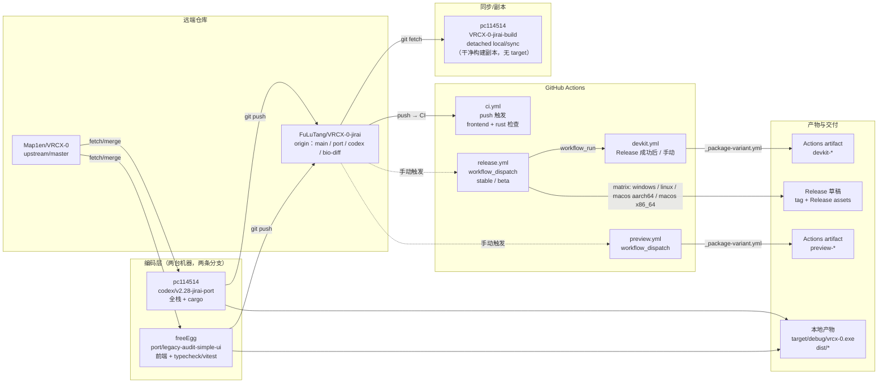

# 仓库编译链路交互图

> 记录 `VRCX-0-jirai` 的多位置 / 多仓库实际分工：谁编码、谁编译、谁推送、谁交付，以及交付到什么位置。
> 全部数据为 2026-11-15 实测，不是推测。未核实项单独标注。

---

## 0. 一句话结论

**编码分成两台机器两条分支（freeEgg 管前端、pc114514 管全栈与 Rust 编译），编译能力分散在两台本机 + GitHub Actions，交付通道是 `release.yml` 手动触发后生成的 GitHub Release 草稿——但截至目前，这个仓库没有发布过任何 tag 或 release。**

---

## 1. 参与方清单

### 1.1 本机与副本

| 位置 | 路径 | 分支 @ HEAD | 承担角色 | 证据 |
| --- | --- | --- | --- | --- |
| `freeEgg`（本机） | `~/Documents/Github/VRCX-0-jirai` | `port/legacy-audit-simple-ui` @ `3200bc3c7` | 编码（前端为主）+ 前端构建 | `node_modules` 560 M、`dist` 10 M、`cargo` 不存在 |
| `pc114514`（主） | `C:\Users\tangh\Documents\Github\VRCX-0-jirai` | `codex/v2.28-jirai-port` @ `83e624a06` | 编码（全栈）+ Rust 编译 | `target/debug/vrcx-0.exe` 存在、6 项未提交改动 |
| `pc114514`（构建副本） | `C:\Users\tangh\Documents\Github\VRCX-0-jirai-build` | detached @ `local/sync` = `f3b3e027c` | 构建用干净副本 | 工作区 clean、无 `target`、存在 `local/sync` remote |
| `pc114514`（校验副本） | `C:\Users\tangh\Documents\Github\VRCX-jirai\VRCX-jirai-baseline-check` | `c7eaf00e` | VRCX-jirai 基线比对 | 与 GitHub master 同提交 |
| `m1pro`（MacBook） | 未知 | — | **未核实**（Tailscale 离线，SSH 超时） | — |

### 1.2 远端仓库

| 仓库 | 角色 | 当前状态 |
| --- | --- | --- |
| `FuLuTang/VRCX-0-jirai`（origin） | 集成与交付目标仓 | 4 个分支：`main`(`0b8a63d61`)、`port/legacy-audit-simple-ui`(`3200bc3c7`)、`codex/v2.28-jirai-port`(`83e624a06`)、`bio-diff`(`d82c18d21`)；**tags 0 个、releases 0 个** |
| `Map1en/VRCX-0`（upstream） | 上游源 | `master` = `acc031e9e`（2026-11-15） |
| `FuLuTang/VRCX-jirai` | 旧版 Electron fork，只读参考 | 10 个分支，`master` = `c7eaf00e` |
| `vrcx-team/VRCX` | 旧版上游 | `master` = `20fe6963`（2026-11-15） |

### 1.3 领先性判定（"最新位置"是哪一个）

| 判定维度 | 领先者 | 数据 |
| --- | --- | --- |
| 提交时间最新 | `freeEgg` 的 `port/legacy-audit-simple-ui` | `3200bc3c7`（2026-11-11）vs `pc114514` 的 `83e624a06`（2026-10-15） |
| 上游基线最新 | `freeEgg` 的 `port/legacy-audit-simple-ui` | 相对 `Map1en/VRCX-0` master 仅 behind 15；`codex` 线 behind 439 |
| Jirai 功能面最广 | `pc114514` 的 `codex/v2.28-jirai-port` | 有 32 个 `port` 分支没有的提交（增强抓取、关系建议、灯色占比、资料历史） |
| 已推送 | 两条线均与 origin 同步 | 无未推送提交（`VRCX-jirai` 旧版那边另有 266 个） |

- 结论：**不存在单一"领先仓库"**。时间与上游基线以 `freeEgg` 的 `port` 分支为准，功能存量以 `pc114514` 的 `codex` 分支为准。二者合并前，任何"最新版"说法都只对某一维度成立。

---

## 2. 链路交互图

### 2.1 主链路



### 2.2 ASCII 备份视图

```text
[freeEgg]  port/legacy-audit-simple-ui ──┐
                                          ├──push──▶ FuLuTang/VRCX-0-jirai (origin)
[pc114514] codex/v2.28-jirai-port ────────┘            │
        │                                              ├─ ci.yml         (push)      → 检查
        ├─ target/debug/vrcx-0.exe  (本地 Rust 产物)    ├─ release.yml    (手动)      → Release 草稿
        └─ VRCX-0-jirai-build (detached local/sync)     ├─ preview.yml    (手动)      → artifact
                                                        └─ devkit.yml     (Release 后) → artifact
Map1en/VRCX-0 (upstream) ──fetch/merge──▶ 两台机器
```

---

## 3. 谁编码

| 机器 | 分支 | 内容 | 状态 |
| --- | --- | --- | --- |
| `freeEgg` | `port/legacy-audit-simple-ui` | 基于 2026-11-11 上游基线的 Jirai 移植（43 个提交），含 tracked non-friends、manual relations、workflow UI、图表搜索选择器 | 已推送，无未推送提交 |
| `pc114514` | `codex/v2.28-jirai-port` | 10-15 那条线，含增强型信息抓取、关系建议、灯色占比、资料历史等 32 个 `port` 分支没有的提交 | 已推送，另有 6 项未提交改动 |
| `pc114514` | `VRCX-jirai`（旧版） | `codex/vrcx-upstream-through-2026-08-15` @ `bd2f45f0`，逐日合并上游 CEF 更新，另有 16 文件已暂存 | **266 个未推送提交**（单点风险） |

- 结论：**编码不是单点**。`port` 与 `codex` 互不包含，合并前必须先定骨架。
- 两台机器都具备完整仓库，但角色不同：`freeEgg` 偏前端，`pc114514` 偏全栈 + Rust。

---

## 4. 谁编译

| 编译对象 | 执行位置 | 证据 |
| --- | --- | --- |
| 前端（Vite/TS） | `freeEgg` | `node_modules` 560 M、`dist` 10 M、Node v24.22.1；本机 `tsc`/`oxlint`/`vitest` 可跑 |
| Rust（cargo check/test/build） | `pc114514` | `target/debug/vrcx-0.exe` 已产出；`freeEgg` 无 `cargo` |
| Tauri 桌面壳 / 安装包 | `pc114514`（本地）或 GitHub Actions（CI） | 本地 `target` 下**未发现** `bundle/**/*.exe|msi`，说明安装包未在本地生成过 |
| 发布构建（正式） | **GitHub Actions** | `release.yml` 的 `package` job，矩阵见下 |

**`release.yml` 构建矩阵**

| label | runner | rust_target |
| --- | --- | --- |
| Windows | `windows-latest` | `x86_64-pc-windows-msvc` |
| Linux Packages | `ubuntu-24.04` | — |
| macOS DMG (Apple Silicon) | `macos-latest` | `aarch64-apple-darwin` |
| macOS DMG (Intel) | `macos-latest` | `x86_64-apple-darwin` |

**其它打包 workflow**（均复用 `_package-variant.yml`，产物只上传 artifact，不进 Release）：

| workflow | 触发 | 平台矩阵 |
| --- | --- | --- |
| `preview.yml` | 手动 | windows_x86_64 / linux_x86_64 / macos_aarch64 / macos_x86_64 |
| `devkit.yml` | `Release` 成功后自动、或手动 | 同上 |
| `ci.yml` | push（路径过滤）/ 手动 | 前端 lint/typecheck/test + Rust 检查 |

---

## 5. 谁推送、谁交付

| 环节 | 承担方 | 方式 |
| --- | --- | --- |
| 代码推送 | `freeEgg`、`pc114514` | `git push` 到 `FuLuTang/VRCX-0-jirai`（origin） |
| 构建副本同步 | `pc114514` 的 `VRCX-0-jirai-build` | 从 `local/sync` remote 拉取（`local` 是本地路径 remote，非 GitHub） |
| 正式交付 | GitHub Actions `release.yml` → `publish-draft` job | `softprops/action-gh-release@v3`，`tag_name` = 由 `scripts/prepare-release-version.ts` 生成的版本号，**`draft: true`**（草稿发布，需人工点发布） |
| 预览交付 | `preview.yml` | Actions artifact，命名 `preview-<platform>-<version>-<timestamp>` |
| Dev Kit 交付 | `devkit.yml` | Actions artifact，命名 `devkit-<platform>-<version>` |

**交付位置**

| 类型 | 位置 | 当前是否存在 |
| --- | --- | --- |
| 正式 Release（含安装包） | `github.com/FuLuTang/VRCX-0-jirai/releases` | ❌ **0 个 release、0 个 tag** |
| Release 草稿 | 同上（`draft: true`） | ❌ 无 |
| Preview artifact | GitHub Actions 该次 run 的 Artifacts | ❌ 无历史记录可查 |
| Dev Kit artifact | 同上 | ❌ 同上 |
| 本地可执行文件 | `pc114514:...\VRCX-0-jirai\target\debug\vrcx-0.exe` | ✅ 存在（debug，非安装包） |
| 前端构建产物 | `freeEgg:...\VRCX-0-jirai\dist` | ✅ 存在（约 10 M） |
| 旧版 VRCX-jirai 安装包 | `FuLuTang/VRCX-jirai` releases | 未核实（本次未查） |

> 交付命名规则可从 `badge-downloads.yml` 反推：Windows 安装包匹配 `_windows_x86_64_setup\.exe$`，说明正式 Release 的资产命名约定是 `VRCX-0_<version>_windows_x86_64_setup.exe` 这一类。

---

## 6. 缺口与风险

1. **交付链从未跑通**：`release.yml` 需要手动触发，且要求仓库变量 `TAURI_UPDATER_PUBLIC_KEY`；当前 0 tag / 0 release，等于没有任何一次完整交付记录。
2. **`port` 与 `codex` 两条编码线互不包含**：`codex` 独有 32 个 Jirai 提交，`port` 独有更新的上游基线（behind 15 vs 439）。合并顺序未定，交付前必须先收敛。
3. **`pc114514` 的 `VRCX-jirai` 有 266 个未推送提交**：单点故障风险最高的一处，不在本仓库链路内但会阻塞旧版功能对照。
4. **`freeEgg` 无 cargo**：本机只能验证前端，Rust 改动一律要在 `pc114514` 或 CI 验证。
5. **构建副本 `VRCX-0-jirai-build` 停在 `f3b3e027c`**，落后 `port` 分支（`3200bc3c7`），且无 `target`，当前不具备即时出包能力。
6. **`m1pro` 未核实**：本次连接超时，是否存在第三份仓库/构建产物未知。
7. **`release.yml` 的草稿策略**：`draft: true` 意味着 CI 跑完不会自动对用户可见，仍需人工在 GitHub 上点发布——"谁最终交付"这一环目前是**人工**。
